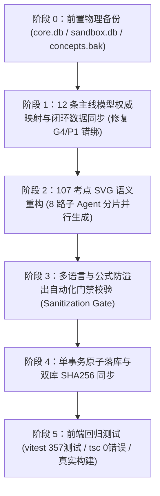

# TASK-DATA-0015 任务计划书
## 12 条主线旗舰模型权威映射修正与 107 考点概念 SVG 多语言/公式门禁重构

> **前置依赖**：TASK-DATA-0014 (沙盒双语补齐已归档), TASK-FE-0023 (UI/交互修复已归档)  
> **任务性质**：数据层权威修正与资产重构专项任务（严格白名单控制，零跨界污染）  
> **执行模式**：并发分片生成（Concurrency = 8）+ 主 Agent 统一校验与单事务原子落库  

---

## 一、任务背景与核心解决目标

在对全库 107 个考点 SVG 资源与 12 条知识主线模型映射的深度诊断中，发现了两项严重的技术债务与教学语义缺陷：
1. **107 个考点 SVG 模板高度重复与语义严重错配**：
   - 全库 107 个考点仅由 13 套静态模板批量硬编码复制（重复率达 87.9%）；
   - 产生 42 处语义错配（如 KP-023 配方法画二元一次两线相交、反比例函数画二次抛物线、等边三角形画直角勾股等）；
   - 缺失 `layer-stage-N` 分层类名，导致四段论精讲“点击阶段假点亮”。
2. **12 条知识主线模型映射存在致命错绑**：
   - 🔴 **G4（圆的几何度量）**：前端错绑为初二模型 `LM-8A-01`（手拉手全等与勾股跃迁），圆主线沙盒内无“圆”；应权威修正为 `LM-9A-24`（切线长定理与内切圆/外接圆模型）；
   - 🔴 **P1（随机现象与概率）**：前端错绑为统计模型 `LM-8B-17`（统计指标加权平均与方差风险决策）；应权威修正为真库概率模型 `LM-9B-37`（概率度量与频率大数定律逼近模型）。

---

## 二、严格范围控制（严格白名单，不碰其他数据）

### 2.1 允许修改的白名单数据（Target Whitelist）
1. **SVG 概念资产文件**：
   - `public/assets/concepts/KP-*-zh.svg`（107 个中文 SVG 矢量文件）
   - `public/assets/concepts/KP-*-en.svg`（107 个英文 SVG 矢量文件）
2. **知识主线元数据与映射**：
   - `data/core.db` 中的 `logic_lines` 表（核对并固化 G4 $\to$ `LM-9A-24`、P1 $\to$ `LM-9B-37`）
   - 前端静态主线映射与类型文件：
     - `src/modules/graph/LineClosedLoop.tsx`（修正 `FLAGSHIP_MODELS_BY_LINE` 中的 G4 与 P1）
     - `src/modules/graph/CombinationPanel.tsx`（修正 `LINE_FLAGSHIP_MAP` 中的 G4 与 P1）
     - `src/modules/graph/mockGraphData.ts`（确保离线兜底镜像与数据库 100% 逐字对齐）
3. **知识点关联元数据（仅限校验与字段同步）**：
   - `data/core.db` 中的 `knowledge_points` 表（仅同步校验 `svg_asset_zh` / `svg_asset_en` 路径有效性与 `primary_line_id`）

### 2.2 绝对禁止碰触的红线清单（No-Touch List）
- ❌ **绝对禁止碰触题库表**：`data/core.db` 中的 `questions` 表（全量 2582 道真题/生成题），禁止任何 `UPDATE` / `DELETE` / `INSERT`！
- ❌ **绝对禁止碰触概念沙盒核心逻辑**：`data/sandbox.db` 中的 `concept_sandboxes`（46 个沙盒的几何图元、滑块范围与探究逻辑原样保留）。
- ❌ **绝对禁止碰触跃迁模型核心参数**：`data/sandbox.db` 中的 `leap_sandbox_models`（37 个模型的 4D 状态机参数与骨架定义原样保留）。
- ❌ **绝对禁止执行破坏性 DDL**：严禁 `DROP TABLE`、严禁 `ALTER TABLE ... DROP COLUMN`。
- ❌ **绝对禁止并发写入数据库**：子 Agent 一律只能生成 JSON/SVG 分片文件，落库必须由主 Agent 在单个事务内串行执行。

---

## 三、物理备份与快照策略（前置强制执行）

在执行任何写操作（文件写入或 SQLite UPDATE）前，必须执行全量物理冷备份，并校验哈希值与大小：

```bash
# 1. 数据库物理备份
cp data/core.db data/core.db.bak_before_task0015
cp data/sandbox.db data/sandbox.db.bak_before_task0015

# 2. 既有 SVG 资源全量物理备份
cp -r public/assets/concepts public/assets/concepts.bak_before_task0015

# 3. 校验备份文件有效性（非空且字节对齐）
ls -lh data/*.bak_before_task0015
shasum -a 256 data/core.db data/core.db.bak_before_task0015
shasum -a 256 data/sandbox.db data/sandbox.db.bak_before_task0015
```

---

## 四、质量门禁与技术契约（Quality Gates）

### 4.1 多语言适配门禁（Bilingual Gate）
1. **中英 1:1 成对产出**：
   - 107 个考点必须严格产出 `KP-{ID}-zh.svg` 与 `KP-{ID}-en.svg`，文件数量严格等于 **214 个**；
2. **英文文本专业性规范**：
   - 英文卡片中的标题（Header）、几何标注、公式说明必须采用标准中考/初中数学英文术语；
   - 严禁机翻生造词，严禁中文拼音混入英文 SVG；
   - 严禁出现 `TODO`、`__PENDING__` 或空文本节点 `<text></text>`。

### 4.2 数学公式与排版过滤门禁（Math Formula & Overflow Gate）
1. **XML 实体安全过滤**：
   - SVG `<text>` 节点中出现数学不等式或特殊符号时，必须进行严苛的 XML 转义：
     - `<` $\to$ `&lt;`
     - `>` $\to$ `&gt;`
     - `&` $\to$ `&amp;`
2. **公式长度与溢出截断防护**：
   - SVG 物理视口严格限定为 `viewBox="0 0 400 300"`，内容有效安全区为宽 360px；
   - 单行公式文本长度门禁：
     - 汉字文本 $\le 22$ 字；
     - 英文/公式文本 $\le 36$ 字符（使用 `-apple-system, sans-serif` 或 `monospace`，字号 $12\sim 13\text{px}$）；
     - 超长复合公式必须主动拆分为多行 `<tspan>`，严禁超出 `x=380` 边界。
3. **LaTeX 规范与代码保护**：
   - 若在数据表文本中涉及 LaTeX，双反斜杠 `\\` 必须严格转义（如 `\\angle`、`\\triangle`、`^\\circ`），防止转义丢失导致渲染溢出。

### 4.3 四段论精讲分层类名契约（Layering Class Gate）
所有重新生成的 107 个考点 SVG，**必须完整包含四段论类名**，杜绝“点击阶段假点亮”：
- `class="layer-stage-1"`：探本溯源直观背景图元（底色、坐标轴、原初几何骨架）；
- `class="layer-stage-2"`：概念建构核心特征图元（主图形、线段、动态标记）；
- `class="layer-stage-3 formal-labels"`：形式化表征标注（点字母、角度标注、公式文本）；
- `class="layer-stage-4"`：变式拓展/高亮特征图元（极值辅助线、特征点、交点解析）。

---

## 五、分步实施计划与分片编排（Execution Pipeline）



### 阶段 0：前置物理备份
- 执行 `core.db`、`sandbox.db`、`public/assets/concepts/` 物理快照与 SHA256 登记。

### 阶段 1：12 条主线旗舰模型权威映射纠偏
1. **数据权威纠偏**：
   - 校验 `data/core.db` 的 `logic_lines`：
     - `G4` $\to$ `flagship_model_id = 'LM-9A-24'`（切线长定理与内切圆/外接圆模型）
     - `P1` $\to$ `flagship_model_id = 'LM-9B-37'`（概率度量与频率大数定律逼近模型）
2. **前端代码同步修正**：
   - 修正 `src/modules/graph/LineClosedLoop.tsx` 中的 `FLAGSHIP_MODELS_BY_LINE`，移除已废弃的错绑；
   - 修正 `src/modules/graph/CombinationPanel.tsx` 中的 `LINE_FLAGSHIP_MAP`；
   - 修正 `src/modules/graph/mockGraphData.ts` 中的主线数据，确保离线与在线一致。

### 阶段 2：107 考点 SVG 语义重构（Concurrency = 8）
利用 `invoke_subagent` 派发 8 个子 Agent 并发处理 8 个考点分片，生成 107 对契合数学本质的高质量 SVG：

| 分片 ID | 考点范围 | 涵盖主要数学内容 | 重点重构与纠偏要求 |
| :--- | :--- | :--- | :--- |
| **Part 1** | `KP-001` ~ `KP-015` | 数与式（实数、整式、因式分解） | 绘制真实数轴连续统、拆项拼图，彻底分离有理与无理图解 |
| **Part 2** | `KP-016` ~ `KP-029` | 方程与方程组（一次、分式、二次） | **重点攻坚**：彻底拔除 KP-021~KP-026 的两线相交模板！KP-023 配方法重画花拉子米正方形割补面积拼图；KP-026 重画判别式切点与割线 |
| **Part 3** | `KP-030` ~ `KP-043` | 函数与图象（正比例、一次、反比例、二次） | **重点攻坚**：彻底拔除 KP-032~KP-037 的抛物线模板！KP-032~035 绘制标准一次直线与象限截距；KP-036~037 绘制标准双曲线与 $k$ 矩形面积 |
| **Part 4** | `KP-044` ~ `KP-060` | 三角形与全等（基本性质、特殊三角形、全等） | **重点攻坚**：彻底拔除 KP-053~KP-055 的直角三角形模板！KP-053/054 重画等腰三角形三线合一；KP-055 重画 $60^\circ$ 等边三角形与对称轴 |
| **Part 5** | `KP-061` ~ `KP-068` | 四边形演化（平行四边形、矩形、菱形、正方形、梯形） | KP-067 重画标准梯形，包含高与中位线，补齐 `layer-stage-2` 类名 |
| **Part 6** | `KP-069` ~ `KP-084` | 圆与图形变换（垂径、切线、对称、平移、旋转） | KP-079 重画轴对称镜像，KP-080 重画向量平移，KP-084 重画三视图正投影 |
| **Part 7** | `KP-085` ~ `KP-091` | 相似与锐角三角函数（三角比、解直角三角形） | 精准绘制对边/邻边/斜边比例，区分 $30^\circ, 45^\circ, 60^\circ$ 特殊角构型 |
| **Part 8** | `KP-092` ~ `KP-107` | 统计与概率（图表、集中/离散、古典概型、树状图） | **重点攻坚**：KP-094 重画标准扇形百分比圆环；KP-095 重画波动折线图；KP-106 重画规范树状图分支；补齐 `layer-stage-3` 类名 |

### 阶段 3：自动化质量门禁流水线
编写门禁校验脚本 `scripts/verify_svg_assets.py`，全量执行四大自动化检测：
1. **文件完整性**：214 个 SVG 必须 100% 存在且非空；
2. **XML 合法性**：通过 `xml.etree.ElementTree` 解析，无非法实体错误；
3. **四段论类名覆盖**：每个 SVG 必须同时拥有 `layer-stage-1`, `layer-stage-2`, `layer-stage-3`, `layer-stage-4` 类名；
4. **排版溢出与公式安全检测**：检测所有 `<text>` 的字符宽度与边界，严禁文本越界。

### 阶段 4：双库同步与原子落库
- 将校验无误的资产同步写入：
  - `data/core.db` 与 `public/data/core.db`（更新时间戳与关联字段）
  - 同步复制 SVG 资产至 `dist/assets/concepts/`（若存在构建缓存）
- 核验两套数据库的 SHA256 保持 100% 相同。

### 阶段 5：全系统回归测试
- `npx tsc --noEmit`：保证 TypeScript 0 类型报错；
- `pnpm vitest run`：保证全套 57 个测试套件、357 个测试用例 100% PASS；
- `pnpm build`：确保 Vite 生产打包零 Warning 成功完成。

---

## 六、量化验收清单（Acceptance Criteria）

- [ ] **判据 1（备份与文件守恒）**：
  - `data/*.bak_before_task0015` 备份完备，SHA256 与原库写前一致；
  - `questions` 表总行数严格守恒为 2582，`concept_sandboxes` 严格守恒为 46，`leap_sandbox_models` 严格守恒为 37。
- [ ] **判据 2（12 主线旗舰模型 100% 权威闭环）**：
  - `G4` 映射为 `LM-9A-24`（圆模型），杜绝手拉手错配；
  - `P1` 映射为 `LM-9B-37`（概率模型），杜绝统计指标错配；
  - `LineClosedLoop.tsx` 与 `CombinationPanel.tsx` 前端呈现与数据库完全对齐。
- [ ] **判据 3（107 考点 SVG 语义自洽率 100%）**：
  - 13 套粗糙模板全面瓦解，KP-023 配方法、反比例函数、等边三角形等 42 处错配完全归零；
  - 214 个中英 SVG 资源文件与考点正文数学本质 100% 自洽。
- [ ] **判据 4（多语言 100% 适配）**：
  - 英文版 SVG 英文标注覆盖率 100%，术语严谨规范，无空节点，无未翻译词汇。
- [ ] **判据 5（四段论无假点亮）**：
  - 107 个考点 SVG 全部具备 `layer-stage-1` ~ `layer-stage-4`，阶段切换图元高亮精准生效。
- [ ] **判据 6（公式与排版零溢出）**：
  - 所有公式通过 XML 实体转义与字符长度限制检测，视口安全区内排版严整，无溢出与截断。
- [ ] **判据 7（系统回归绿灯）**：
  - `pnpm vitest run` 357 测试用例 100% PASS，`pnpm build` 顺利通过。
