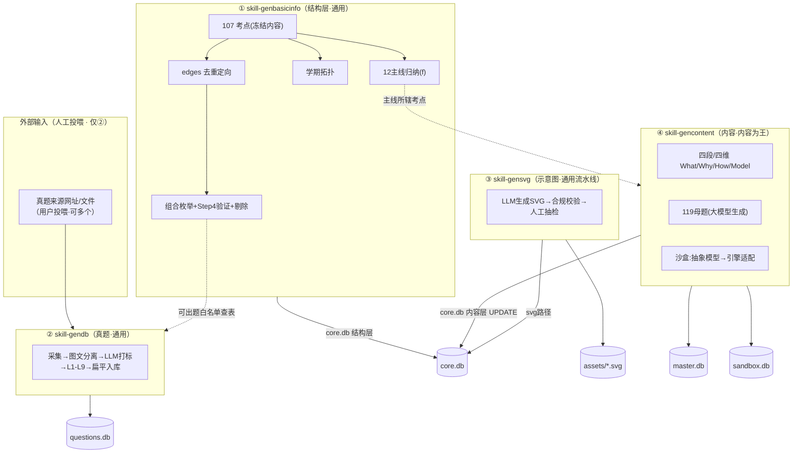
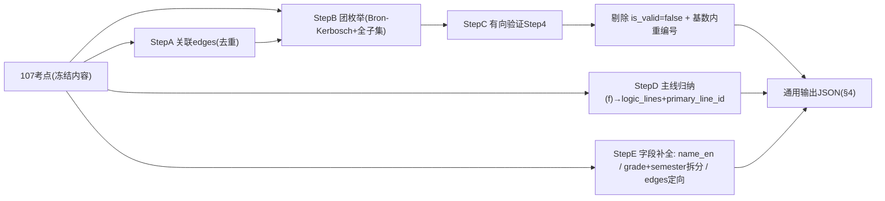
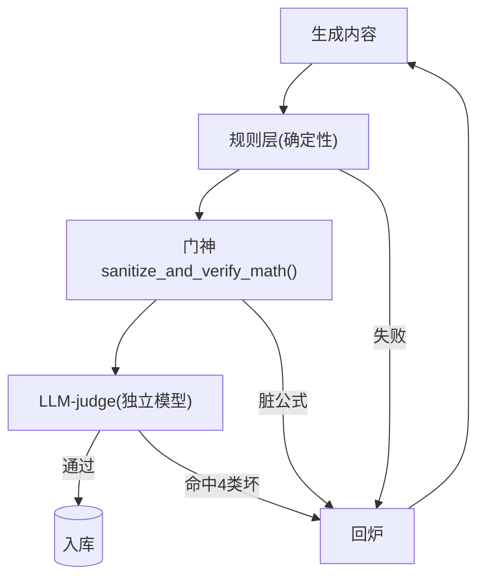
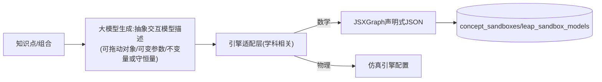

# 设计文档：通用理科基础数据层（math-junior-datalayer）

> **Feature**：`math-junior-datalayer`
> **文档定位**：本文档是「基础数据层 / 数据准备项目」的可落地设计依据，收敛 `requirements.md` 的需求为具体生成逻辑、数据流、入库映射与验收方案。以前端 `math-junior-frontend/design.md §3(CT-1~CT-8) + §4.2 DDL` 为交付契约。
> **通用性原则**：所有 skill 的**机制/结构学科无关**，学科差异隔离到"考点数据 + Prompt 模板 + 引擎适配"。初中数学是首个验证学科。
> **待补**：§6 主线归纳逻辑 f（等用户文档），仅阻塞"主线归纳/主线精讲"子任务，不阻塞其余。

---

## 1. 总体架构

### 1.1 数据生产拓扑（四 skill → 四分包）



### 1.1b 流程重构：两阶段 + 已加工标签（D21~D24，为准）

> 本设计原按 skill ①②③④ 组织；**流程重构后以"两阶段"为执行主线**（requirements §8）。下文各 skill 的生成逻辑（§2~§5）作为"怎么产每类数据"的技术依据仍有效，但**编排顺序以两阶段为准**：

```
阶段一 骨架入库(能占位就占位, content_status=pending):
  步1-2 core.db 考点/主线骨架   ✅已完成(§2)
  步3   master.db 母题骨架       (大模型生成题面, 四维占位)
  步4   sandbox.db 沙盒模型表     (数学=实验室二手册结构化直录; 通用=大模型生成对应表)
  步5   questions.db 真题骨架     (tools/docimport 导入原生OMML docx, 缺字段占位)
阶段二 大模型回填加工(打 content_status=done):
  步6   从各表取 pending → 大模型填内容字段 → 门神 → done (可断点续跑)
        core四段/主线精讲、master母题四维、sandbox配置文本、questions考点/双语/算分/rubric
完成判据: 四库 content_status 全 done + 无 __PENDING__ 残留。
```

- **已加工标签**：各内容表加 `content_status VARCHAR(12) NOT NULL DEFAULT 'pending'`（pending/processing/done）。回填器 `WHERE content_status='pending'`，填完置 done，断点续跑不重复。
- **tools/docimport**（步5 工具，见 `tools/docimport/README.md`）：本地 Pandoc 抽取，仅收体检 PASS 的原生 OMML docx；WMF碎片/扫描件拒收（需多模态，另议）。

### 1.2 依赖顺序与验收闸（分段）

```
段1【①】skill-genbasicinfo → core.db 结构层 + 内容层占位
        →〔闸1〕结构完整性验收（边数/编号/字段/主线/拓扑）
段2【②】skill-gendb（输入停靠:投喂网址）→ questions.db
        →〔闸2〕真题质量验收（扁平schema/枚举/图文/L1-L9金标校准）
段3【③】skill-gensvg → assets + svg路径回填
        →〔闸3〕SVG合规验收 + 人工抽检
段4【④】skill-gencontent → core内容层UPDATE + master.db + sandbox.db
        →〔闸4〕内容质量验收（守底线rubric + 门神 + 数量核对）
```
每闸不过不放行下一段；回炉上限 3 次，超限抛用户（§7 熔断）。
**依赖**：② 查 ① 的组合白名单；④ 母题/精讲用 ① 的考点/主线；③④ UPDATE core.db 需 ① 先建表。故顺序 ①→②/③/④（②③④ 之间可并行，但均依赖 ①）。主线归纳/主线精讲依赖 §6 f。

### 1.3 与前端契约的关系
- 交付目标 = 前端 `§4.2 DDL`（本项目 `scripts/build/db/schema.sql` 已存在，作为权威建表）。
- 本项目**产数据填库**，不改前端代码。若数据事实要求前端契约微调（如组合总数从 2205 变为剔除后数、字段语义对齐 What/Why/How/Model），记入 §8「契约变更提示」，交前端 owner 确认，不擅改。

---

## 2. ① skill-genbasicinfo（结构层）

### 2.1 Bug 修正（已实测定位，见讨论记录）

| Bug | 现状 | 根因 | 修正 |
| :--- | :--- | :--- | :--- |
| B1 边未去重 | `edges` 数组 498、meta 498 | `build_graph` 的 `ve` 逐条 append，输入含 5 条重复边 | `ve` 用有序集合去重；`total_edges` → 493 |
| B2 组合ID全局编号 | C3 从 0494 起、C8 到 2098 | `enumerate(sorted(combos))` 用全局 `ci` | 改为**基数内计数器**：`C{size}-{该基数内序号:04d}`，各基数从 0001 起 |
| B3 Step4 未跑 | 2098 组合 is_valid=null、hint 空 | 执行时 config 的 `directed_validation` 为空就跑 Step3 出终稿 | Step4 必须真跑并回填后再出终稿（§2.3） |

### 2.2 处理链（以 107 考点为唯一输入根）



### 2.3 StepC 有向验证（真跑，全量）
- 对每个 size≥2 组合，LLM 判定：`is_valid`（能否自然出一道同时直接用到全部考点的题）、`directed_order`（教学解题顺序）、`question_hint_zh/en`（≤15字出题思路）、`question_types`（该组合适用题型子集）。
- **剔除**：`is_valid=false` 的组合丢弃，不入库；`is_question_valid` 字段不进 core.db；剩余组合**基数内重新连续编号**。
- 单考点（size=1）：107 个，`is_valid=true`，hint 可为该考点单点出题提示。
- **用途双重**：留存组合 = ②采题的"可出题白名单"（查表匹配 combination_id）；question_hint = 真题↔考点组合反向查询锚点。

### 2.4 StepD 主线归纳（f 已定稿，§6）
- 输入：考点集合 X（含 domain/subcategory/grade）+ 学科（用于范式族路由）。
- 逻辑 f（全自动，无人工复核）：
  1. **范式族路由**：数理化→族A、生物→族B（agent 逻辑分支按输入学科判定）。
  2. **Step-1 归档**：按 domain 分大类。
  3. **Step-2 分支**：在每大类内，用该族维度词表（族A:公理/结构/变换/度量/数据；族B:构成/机制/过程）prompt 归纳出主线。
  4. **单归属**：跨维度考点取最主导维度（prompt 内定优先级）→ `primary_line_id`。
- 输出：`logic_lines` 骨架（line_id/name_zh/en/domain/semester_span/member_kp_ids）+ 每考点 `primary_line_id`。
- `semester_span`：由该主线所辖考点的最小~最大学期推出（如 "7-2 ~ 9-1"）。
- 数学预期 Y = 12（A1~A4/G1~G6/S1/P1）；数量不写死，由 domain + 分支派生。

### 2.5 StepE 字段补全（纯规则，不用 LLM 的部分）
- **grade+semester 拆分**（纯映射，已验证 107/107 可切）：
  `七年级上→(7,1)` `七年级下→(7,2)` `八年级上→(8,1)` `八年级下→(8,2)` `九年级上→(9,1)` `九年级下→(9,2)`
- **ID 格式**：`KP001→KP-001`（3位补零）；组合 `C{size}-{基数内序号}`。
- **拓扑定向 predecessors/successors**（纯规则）：对每条无向 edge (a,b)，按学期先后定向——学期靠前者为前置、靠后者为后继；同学期按考点编号或 subcategory 内在先后。产出 `graph_topology`。
- **name_en**（LLM，107 条术语翻译）：数学术语标准英译，术语表可复用。
- **is_milestone**（规则）：主线关键枢纽考点（被组合引用次数 top + 大考点）标 true。
- **module_name**：默认 = subcategory。

### 2.6 入库映射 → core.db 结构层

| JSON 段 | → core.db 表 | 字段映射 |
| :--- | :--- | :--- |
| knowledge_points | knowledge_points | id→point_id；name_zh/en/grade/semester/domain/subcategory/primary_line_id/is_mandatory 直填；**svg路径→③占位；四段精讲→④占位** |
| logic_lines | logic_lines | line_id/name/domain/semester_span 直填；**四段精讲/master_example_id/flagship_model_id→④占位** |
| combinations | knowledge_combinations | id→combination_id；kp_ids/kp_count/directed_order/question_hint_zh/en/question_types 直填 |
| graph_topology | knowledge_graph_semesters | node_id/point_id/grade_semester/module_name/predecessors/successors/is_milestone 直填 |

### 2.7 占位规则（内容层 NOT NULL，④ 覆盖）
- 结构阶段，core.db 中属 ③/④ 的 NOT NULL 字段填**合规占位**，保证建表通过、前端可 mock：
  - 四段精讲 TEXT 字段 → `"__PENDING_CONTENT__"`
  - svg_asset_zh/en → 约定路径 `assets/concepts/{point_id}-{lang}.svg`（③ 生成文件，路径先占）
  - logic_lines.master_example_id/flagship_model_id → `"__PENDING__"`（④ UPDATE）
  - knowledge_points.master_example_id/sandbox_id → NULL（可空，④/③ 回填）
- ④/③ 完成后 **UPDATE** 覆盖占位。验收闸4 校验：core.db 中不得残留 `__PENDING__`。

---

## 3. ② skill-gendb（真题库）

### 3.1 关键改造：直出前端扁平 schema（D3）
- 原 SKILL 节点4 产"打包 JSON 大字段"（content/options/answer/solutions 塞 JSON）。**改为直接产前端 `questions` 扁平列**，砍掉二次 ETL。
- 字段对齐（改造点）：

| 项 | 原 skill | 改为(前端契约) |
| :--- | :--- | :--- |
| question_type | 中文 选择/填空/解答 | `single_choice`/`fill_blank`/`solution` |
| difficulty_level | "L1".."L9" 字符串 | 整数 1~9 |
| KP id | KP071 | KP-071 |
| 题干/选项/答案 | content/options/answer 打包 | stem_zh/stem_en/options_json/answer_standard 扁平 |
| 解答踩分点 | solutions.steps | rubric_checklist_json（stepIndex/desc_zh/en/points）+ solutions_json |

### 3.2 流程（保留 SKILL 四节点，修正产出）
1. **输入停靠点**：等用户投喂真题来源（网址/文件，可多个）。
2. 节点1 数据获取 + Pandoc 图文分离（`--extract-media`，图片原位锚定，防错位）。
3. 节点2 LLM 多模态打标（有效性/题型/三段拆分/多解法/认知打分/双语）。
4. 节点3 本地查表：主解法 KP `sorted` → 在 ① 白名单查 combination_id；越界丢弃。双引擎 L1-L9 算分。
5. 节点4 扁平入库 questions.db + 运行报告（总数/入库/无效丢弃/越界丢弃/成功率）。

### 3.3 图文分离与图片资产
- Pandoc 转换后，`` 原位锚定，切题不错位。
- "如图"关键词数 vs 图片数 差值 > 2 → 丢弃该题（不降级）。
- 图片路径写入 `questions.image_paths_json`。

### 3.4 L1-L9 双引擎算分（保留算法）
- 结构广度分（知识点数量档 + 组合跨度 scope）+ 认知深度分（insight×1.5 + hidden×1.0 + calc×0.5）→ 映射 L1~L9，整题取子题 MAX。
- **金标校准见 §5**。

---

## 4. ③ skill-gensvg（示意图 · 通用流水线）

### 4.1 流水线（机制学科无关）


### 4.2 合规校验器（通用·确定性·机器可判）
硬规则（任一不过即回炉）：
- 无 `<foreignObject>`（属性 P20）
- 合法 `viewBox`、`preserveAspectRatio`
- 文本/符号矢量路径化（数学符号不依赖外部字体渲染）
- 无 `<script>`、无外链、无事件属性
- zh/en 两版齐全，路径匹配 `{point_id}-{lang}.svg`

### 4.3 正确性 = 人工抽检（机器判不了）
- 校验器只保证"合规"，不保证"这张图正确表达了该考点"。
- 抽检机制：按批抽样（如每批 20%）教研目检；不合格定点回炉。抽检结论记 ACCEPTANCE_LOG。

### 4.4 学科适配
- 唯一外挂 = "学科示意图 Prompt 模板"（数学:几何/函数/数轴规范；物理:电路/受力规范）。流水线与校验器不变。

---

## 5. ④ skill-gencontent（内容 · 内容为王）

### 5.1 四段/四维 = What/Why/How/Model（通用认知阶梯）

| 认知层 | 考点四段字段 | 母题四维 | 主线四段字段 | 必填? |
| :--- | :--- | :--- | :--- | :--- |
| What 是什么 | intuitive_essence | dim2_essence | （主线整体本质） | 大考点必填 |
| Why 为何 | origin_story | dim1_origin | origin_foundation | 大考点必填 |
| How 怎么用 | formal_definition | **dim3_rigor** | methodology | **恒必填** |
| Model 变式建模 | intrinsic_variation | dim4_traps | exam_matrix / spiral_leaps | 不强求（基础考点可薄/缺） |

> 字段名沿用前端 schema（数学味），但语义锚定 What/Why/How/Model；换学科语义不变、内容变。

### 5.2 自适应深度（能深必深，不强行深）
- 大考点（几何/函数/圆等，约40个）：四层做满。
- 三维/双维/一维考点：按前端 §5.4 梯队，How 恒必填，Model 允许薄或缺。
- **验证器不因"层浅"判失败**（§5.5）。

### 5.3 母题生产（大模型生成，独立于②真题）
- **来源**：大模型基于经典题型自主生成（输入=考点/主线/组合），**不投喂网址、不依赖②**。
- **数量**：考点母题 |X|（每考点1道 point_master）+ 主线母题 |Y|（每主线1道 line_master）= 数学 107+12=119。
- **定位**：考点母题=标杆题（难度适中）；主线母题=压轴综合题（高难，`empirical_scoring_rate ∈[0.15,0.35]` 为**模型估算值**，标注）。
- **物理隔离**：入 master.db，绝不混 questions（CT-8/P17）。ID `ME-KP023`/`ME-LINE-A4`。
- 四维：dim3 恒必填；几何/函数大考点母题 ≥3 维（CT-6）。

### 5.4 主线精讲（考点四段向上归纳）【依赖 §6 f】
- 输入 = 主线 + 所辖考点 + 这些考点的考点四段（微观）。
- 逻辑 = 向上归纳为主线四段（宏观）：What(主线本质)/Why(origin_foundation 螺旋地基)/How(methodology 通用方法论)/Model(exam_matrix 考法矩阵 + spiral_leaps 进阶跃迁)。

### 5.5 质量方案（生成端争取 + 验证端守底线 + 不过严）

**生成端（主杠杆 = Prompt）**：名师视角、What/Why/How/Model 结构强制、"顶级 vs 平庸"few-shot 对照、"教思维原理不教套路"硬约束。模型由 agent 配置（默认见需求8）。

**验证端（守门员，不评优，自适应）**：

- 规则层：字段存在性；无偷懒词("综上"/"略")；引用考点/公式在字典内。
- 门神：公式清洗（定界符归一/符号标准化/栈式括号校验/KaTeX headless 预检），脏公式绝不入库（P21，复用前端 §6.1 已验证实现）。
- LLM-judge：仅拦 4 类坏——①空洞堆结论 ②幻觉 ③公式错 ④该讲原理处偷懒。**自适应：大考点查四层，基础考点不强求 Model，层浅不判败。**
- rubric 可复用：数学 rubric 定好，换学科改几条。

### 5.6 沙盒 / 实验（通用抽象 + 引擎适配）


- **抽象层通用**：数学=模型、物理=实验，都抽象为"对象+参数+不变量"。
- **适配层学科相关**：数学产出填 `viewbox_spec_json/drag_points_json/param_sliders_json/invariants_display_json`（JSXGraph）。
- **选点（缺口1）**：概念沙盒非全107，选适合可视化交互的考点（约40-50，几何/函数/数轴优先）；`sandbox_id` 空⇒前端占位卡。
- **跃迁模型（缺口2）**：36 模型 + 12 旗舰以"实验室二手册"结构化入库；数量按学科手册。

---

## 6. 主线归纳逻辑 f（X → Y · 已定稿）

见 requirements §6。核心：

```
f(X) → Y (全自动, 无人工复核):
  Step-1 归档:   按 domain 把考点分入大类(教材自带领域)
  Step-2 分支:   在每大类内, 按【范式族维度词表】切主线
  范式族路由(agent 逻辑分支, 按输入学科):
     数学/物理/化学 → 族A: [公理/定律, 结构/形式, 变换/不变量, 度量/定量, 数据/推断]
     生物           → 族B: [构成层次, 规律机制, 过程功能]
  单归属: 跨维度考点取最主导维度(prompt 内定优先级)
  Y = 各大类主线之和 (数量派生, 数学=12)
```

- StepD（§2.4）据此实现：读入学科 → 路由范式族 → 选维度词表 → prompt 归纳。
- 主线精讲（§5.4）沿用同一范式族维度做"考点四段→主线四段"的向上归纳。
- **通用边界**：本 skill 覆盖数理化(族A)+生物(族B)。自然地理/小学科学为未来可选扩展点(留接口，本期不实现)；文科不在范围(另立 skill)。

---

## 7. 协作与验收机制

### 7.1 两层验收（关键区分）

**第 1 层 · 段内循环质检（在 Antigravity 内，opus 做，过程）**
```
flash 执行一个任务 → Antigravity 内 opus 按 rubric 快速质检 → 打回/放行
目的: 让 flash 每步不跑偏、快速迭代收敛。
性质: 与执行同链，非独立第三方。
```

**第 2 层 · 交付门禁验收（在本工作区，Kiro 做，独立实测，决定封板）**
```
一段全部跑完 → 产物放入工作区(data/ assets/) → Kiro 亲自跑 SQL/查文件实测
  → 结论记 ACCEPTANCE_LOG → 通过才放行下一段
目的: 独立于执行链，拿真实产物核对契约。
铁律: 不以执行方/第1层自报为准；必须实测数据本身。
       (前端项目 ACCEPTANCE_LOG 批次#1 即因独立实测查出门神 D1 缺陷而退回)
```
- 熔断：第 1 层同任务回炉上限 3；第 2 层某闸退回后，执行方整改再交，仍走独立实测复验。
- 交付形式：产物**直接放入工作区**（`data/*.db`、`data/*.json`、`assets/`），Kiro 才能独立实测（`sqlite3`、`find` 等），不接受仅文本粘贴。
- 模型为可切换默认配置（执行=flash-3.8，第1层质检=opus 4.6），非硬约束。

### 7.2 验收护栏（三条铁律）
1. **rubric 写死**：每段配机器可对照 checklist，标准不漂移。
2. **实测优先**：实际跑/查数据（边数=493、combination_id 无重复无空洞、字段真非空、无 `__PENDING__` 残留、母题不混入 questions…），不信自报"测试全绿"。
3. **熔断**：同闸回炉≤3，超限停并抛用户。

### 7.3 分段验收 rubric（各闸硬项摘要）

**闸1（①结构层）**
- [ ] edges 去重后 = 493；无重复边；`meta.total_edges`=493
- [ ] combination_id 基数内从 0001 连续、无空洞、全库唯一
- [ ] is_valid=false 已剔除；无 `is_question_valid` 字段；组合数 = 剔除后实际数
- [ ] 107 考点 point_id 全为 `KP-0xx`；name_en 全非空；grade∈{7,8,9}、semester∈{1,2} 全合法
- [ ] primary_line_id 全非空且指向存在的 logic_line；12 主线骨架齐全【依赖f，f未到则标注暂归】
- [ ] graph_topology：每考点有 predecessors/successors；grade_semester 格式 "g-s"
- [ ] core.db 可建表；内容层字段为合规占位

**闸2（②真题）**
- [ ] questions 为扁平列；question_type/difficulty_level/ID 格式对齐契约
- [ ] combination_id 均在 ① 白名单内；越界题已丢弃并计数
- [ ] 图文分离抽检：图题图片路径正确、无错位（人工抽样）
- [ ] **L1-L9 金标校准**：30~50 题人工金标 vs 算分，±1 级内 ≥80%（阈值可调）
- [ ] 运行报告字段齐全

**闸3（③SVG）**
- [ ] 每考点 zh/en 两版；路径回填 core.db
- [ ] 合规校验全过：无 foreignObject/script、viewBox 合法、矢量化
- [ ] 人工抽检正确性（每批抽样）

**闸4（④内容）**
- [ ] 数量核对：考点四段 |X| 组、主线四段 |Y| 组、母题 |X|+|Y|、沙盒选点数、跃迁模型数
- [ ] core.db 无 `__PENDING__` 残留（内容层已 UPDATE 覆盖）
- [ ] 门神：随机抽查公式合规；构造脏公式验证被拒
- [ ] LLM-judge 抽检：无 4 类坏；dim3/How 恒非空
- [ ] 母题物理隔离：master_examples.example_id ∩ questions.question_id = ∅
- [ ] empirical_scoring_rate ∈[0.15,0.35] 且标注为估算

### 7.4 台账
每闸结论记 `ACCEPTANCE_LOG.md`（沿用前端格式：批次/自报/实测明细/缺陷Dx/隐患Hx/门禁决定）。

---

## 8. 契约变更提示（交前端 owner 确认，不擅改）

| 项 | 前端现状 | 数据事实 | 建议 |
| :--- | :--- | :--- | :--- |
| 组合总数 | 注释"2205 个" | 剔除 is_valid=false 后 ≤2205 | 更新注释为实际可出题数 |
| logic_lines 字段语义 | origin_foundation 等数学味命名 | 对应 What/Why/How/Model | 加注释说明认知阶梯语义（不改列名，避免破坏前端） |
| is_question_valid | 前端无此列 | 本项目剔除后不产该列 | 无需改（已一致） |
| content_status | 前端无此列 | 本项目新增（生产追踪，pending/processing/done） | 前端只读时忽略该列即可；纯生产用，不影响消费 |
| edges 数 | design §7.2 写"493 条依赖边" | 去重后确为 493（原 498 是含重复） | 前端表述正确，本项目修正 JSON meta 到 493 |

---

## 9. 通用性验证（skill 成为可复用工具的判据）

初中数学全程跑通 + 四闸通过后，判定 skill 工具通用性：
- 输出 JSON 结构学科无关（换 subject 仅换考点内容）；
- 数量按 |X|/|Y| 公式派生，非硬编码；
- 四段/四维 = What/Why/How/Model 学科无关；
- 沙盒抽象层学科无关，仅引擎适配层换；
- Prompt 模板/引擎适配为外挂，换学科改外挂即可。
- **验收结论写入 ACCEPTANCE_LOG，作为"下一个学科（初中物理等）直接复用"的依据。**
