# 设计文档：全科核心素养提分系统 V2.0 — 初中数学模块（前端应用与数据消费层）

> **Feature**：`math-junior-frontend`
> **文档定位**：本文档是初中数学模块**前端四大模块 + 数据消费层**的可落地设计依据。它在既有 [`PRD_V2.0.md`](../../../docs/PRD_V2.0.md)、[`technical_architecture.md`](../../../docs/technical_architecture.md)、[`detailed_design.md`](../../../docs/detailed_design.md)、[`ui_ue_design_specification.md`](../../../docs/ui_ue_design_specification.md) 之上收敛并固化关键架构决策，作为工程实现的单一真实源（SSOT）。凡本文与旧文档冲突之处（尤其 UI/UE 文档中重复自相矛盾的 12.1/12.2 半套内容），**以本文档为准**。

---

## 1. 概述与范围边界

### 1.1 项目定位
本项目交付一个 **纯静态、离线优先、免登录、零持久化** 的初中数学素养提分 Web 应用，覆盖 PRD 第 5 章定义的四大模块：

1. 探本溯源·概念精讲（107 考点四段论 + 链接沙盒 + 1 道考点母题 + 3 题单点快练）
2. 经纬纵横·思维图谱（6 学期 × 12 主线泳道地铁图，**纯静态知识结构展示 + 焦点穿透**）
3. 见微知著·实验探究（双轨沙盒，JSXGraph 声明式驱动）
4. 百炼成钢·实战测评（精准出题中心 + 在线测评中心）

配套一层 **数据消费层与契约适配（ETL）**，负责将上游"打包 JSON"结构映射为前端消费用的 `math_junior.db` 扁平 schema，并承载**构建期大模型内容生成**（母题四维解剖、考点四段精讲、主线精讲、沙盒配置文本）。

### 1.2 范围边界：只读上游依赖（本项目不实现、不修改）

以下两项视为**只读上游契约边界**：

| 上游依赖 | 归属 | 本项目关系 |
| :--- | :--- | :--- |
| 基础数据字典（107 考点、2205 知识点组合、edges 依赖边、107 考点双语 SVG 资产） | 独立"数据准备项目" | **只读消费**。开发期用 mock db 先行。 |
| `skill-genbasicinfo` / `skill-gendb` 流水线 | 独立项目 | **不改动**。仅通过 ETL 适配其产出。 |

> **本项目实现范围**：前端 SPA（React+TS+Vite）、WASM SQLite 消费层、契约适配 ETL、构建期内容生成管线、数学门神（入库清洗 + 出库渲染）、判分引擎、JSXGraph 声明式沙盒引擎、iOS 27 液态玻璃 UI 与三端交互调度、i18n。

### 1.3 已删除的功能（B1 决策）
以下依赖**历史答题记录**的功能因与"零持久化"原则硬冲突，**彻底删除，不予实现**：

- ❌ 学情热力图（节点掌握度着色 🟢🟡🔴）
- ❌ 认知断层逆向溯源 `traceRootCause()`（BFS 前驱遍历）
- ❌ 红色脉冲溯源虚线（`rootCausePulse` 动效）
- ❌ 靶向就医卡片
- ❌ 一切基于 `PointMastery` / `accuracy` 的诊断

> **模块二回归**为纯静态知识结构展示 + 焦点穿透（见 §7.2）。旧 detailed_design.md 第 6 节 `traceRootCause` 与 ui_ue 第 7.2 节脉冲红线、第 6 节 `--status-*`/`--pulse-track` token 一并作废。

### 1.4 保留的纯内存会话态
仅保留刷新即清空的会话内存状态（`presented_ids` 去重集合、即时得分、沙盒滑块值、当前语言、设备 override）。**不写 localStorage / IndexedDB**（见 §7 与属性 P13）。

---

## 2. 技术栈与总体架构

### 2.1 技术选型（C1 决策）

| 层 | 选型 | 关键约束 |
| :--- | :--- | :--- |
| 框架 | **React 18 + TypeScript** | 组件化、类型安全 |
| 构建 | **Vite**，静态导出（`vite build` 产出纯 JS/HTML/CSS） | **纯静态 = 无后端服务器**，不等于不用框架 |
| 离线 | **PWA**（Service Worker 预缓存 app shell + 数据分包） | 断网可用 |
| 数据库 | **`@sqlite.org/sqlite-wasm`**（官方 WASM 构建） | 放 **Web Worker**，**只读连接**，**分包按需加载** |
| 数学渲染 | **KaTeX 本地离线 + WOFF2 内嵌字体** | 全局唯一 `<MathRenderer>` 单出口 + LRU 缓存，`throwOnError:false` |
| 状态管理 | **轻量（Zustand 或 Context）** | 纯会话内存，无持久化 |
| 动态几何 | **JSXGraph** | 声明式配置驱动（见 §9） |
| i18n | **静态 JSON 字典（zh-CN/en）+ `data-i18n` 键绑定热切换** | 数据层双语字段投影 |

> **"纯静态"澄清**：React 产物是标准 JS/HTML/CSS，与运行引擎无关，同样兼容 Blink / WebKit / Gecko。所谓"无后端"指无应用服务器、无 API、无云端 DB，全部计算下沉到浏览器 WASM 与 JS。

### 2.2 引擎兼容策略
- **降级与 polyfill**：`browserslist` 声明目标引擎 → Vite（`@vitejs/plugin-legacy`）自动生成降级包与 polyfill。
- **WebKit 避坑规范（保留）**：
  - SVG **禁用 `<foreignObject>`**（数学符号一律矢量路径化，见属性 P14）。
  - 触控画布强制 `touch-action: none;` + `-webkit-overflow-scrolling: touch;`。
  - KaTeX **内嵌本地 WOFF2**，杜绝 Safari 字体缺失错位。
- **Blink**：启用 WASM SIMD 加速。**Gecko**：保证 SVG 复合图层亚像素对齐。

### 2.3 数据库分包按需加载（关键修订）
不再一次性把整库读入内存。按访问模块分包：

```
data/
  core.db          # 骨架元数据：knowledge_points / logic_lines / knowledge_combinations
                   # / knowledge_graph_semesters（应用启动即加载，体积最小）
  master.db        # master_examples 母题库（进入模块一/二母题时按需 fetch）
  sandbox.db       # concept_sandboxes / leap_sandbox_models 配置（进入模块三时按需 fetch）
  questions.db     # questions 真题库（进入模块一快练 / 模块四组卷时按需 fetch）
```

Worker 对每个分包建立独立只读连接，`fetch` → `ArrayBuffer` → 挂载。

> **性能目标定位为"待验证目标"而非承诺**：完整数据体量 20~50MB、单次复杂查询 <15ms 是**目标基准**，需通过 §12 风险验证后确认，不作为设计硬保证。

### 2.4 总体架构拓扑

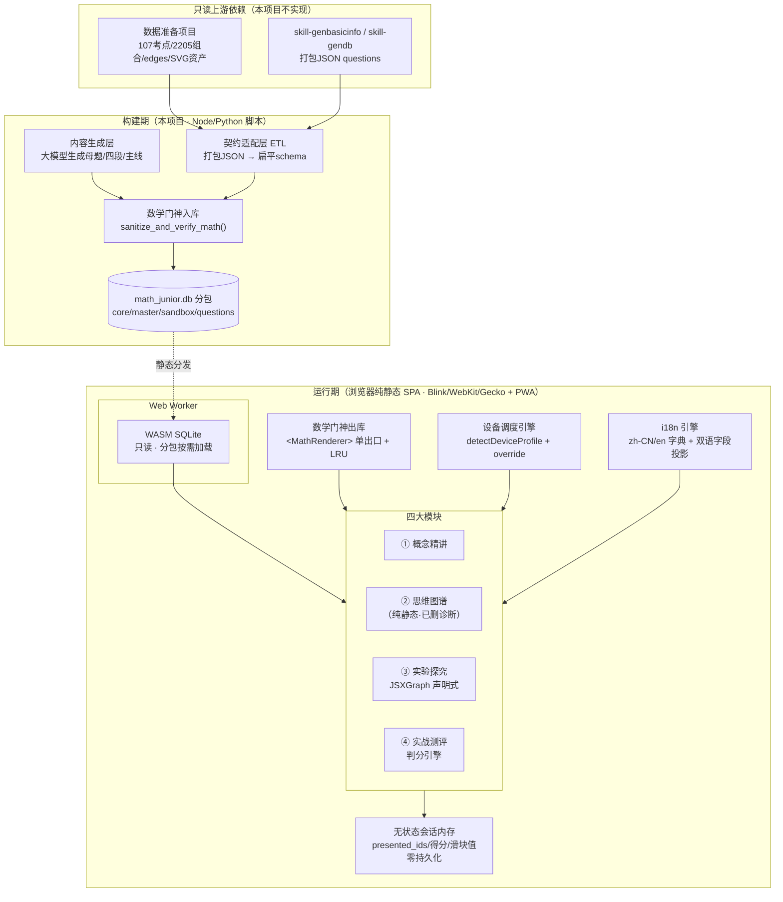

### 2.5 运行期数据消费时序（以模块一单点快练为例）

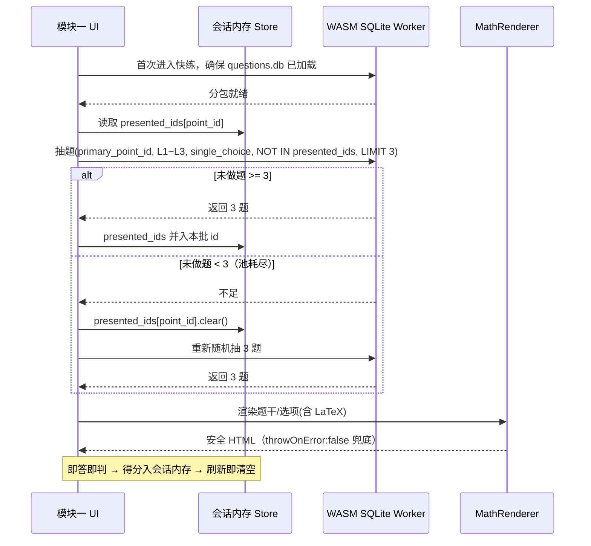

---

## 3. 上游数据契约（内联）

本节明确本项目**需要上游提供**的数据。上游 `skill-gendb` 产出的 `questions` 是"打包 JSON 大字段"结构；本项目通过 §4 的 ETL 适配为前端扁平 schema。开发期以 mock db 满足此契约即可先行。

### 3.1 上游 questions 打包 JSON 结构（契约输入形态）
上游每条真题记录为一个打包对象（示意）：

```typescript
/** 上游 skill-gendb 产出的打包 JSON 记录（只读契约，本项目不修改上游） */
interface UpstreamPackedQuestion {
  question_id: string;                 // "Q-2022-YN-009"
  meta: {
    source: string; exam_year?: number; region?: string;
    exam_type: string; grade_level: number; semester: number;
  };
  tagging: {
    primary_point_id: string;          // "KP-023"
    combination_id?: string;           // "C3-0112"
    difficulty_level: number;          // 1~9（双引擎算分结果）
    question_type: 'single_choice' | 'fill_blank' | 'solution';
    score_default?: number;
  };
  content: {
    stem: { zh: string; en: string };  // 含 LaTeX
    options?: Record<'A'|'B'|'C'|'D', { zh: string; en: string }>;
    answer_standard: string;           // 选择题=字母；填空=LaTeX 表达式
  };
  rubric?: Array<{ step: number; desc: { zh: string; en: string }; score: number }>;
  solutions?: Array<{ method_zh: string; method_en: string; steps: string[] }>;
  images?: string[];                   // 矢量/位图路径
}
```

### 3.2 本项目需要上游明确保证的契约条款

| 编号 | 契约条款 | 约束 |
| :--- | :--- | :--- |
| CT-1 | `difficulty_level` 取值 | 整数 **1~9** |
| CT-2 | `combination_id` 指向的组合基数 `kp_count` | 整数 **1~8**（**非** 1~4，见 C3/§11.3） |
| CT-3 | `question_type` 枚举 | `single_choice` / `fill_blank` / `solution` |
| CT-4 | `answer_standard` | 选择题为单字母；填空题为**经上游数学门神清洗过**的 LaTeX |
| CT-5 | `rubric`（解答题） | 每步含 `desc` 双语与 `score`（整数分值） |
| CT-6 | 母题几维 | 母题 `dim3_rigor` 必填；几何/函数大考点母题 `dim1~dim4` 至少 3 维 |
| CT-7 | 基础字典完整性 | 107 考点、2205 组合、edges、双语 SVG 资产齐全且 ID 规范（见 §11） |
| CT-8 | 母题物理隔离 | 母题在 `master_examples`，**绝不混入** `questions`（见属性 P12a） |

> **注**：若上游 questions 中含未清洗 LaTeX，ETL 阶段仍会二次经过本项目的 `sanitize_and_verify_math()` 门神（见 §6），双重保险。

---

## 4. 数据消费层与契约适配层（ETL）

### 4.1 职责
契约适配层是一个**构建期 Node/TS 脚本**（不改上游 skill），把 §3 的上游打包 JSON **无损**映射为前端消费用的扁平列 schema，写入 `math_junior.db` 分包。运行期前端只面对扁平 schema，永不解析上游打包结构。

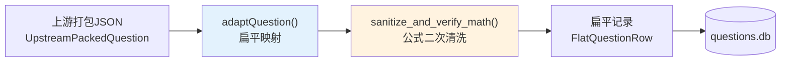

### 4.2 前端消费用扁平 Schema DDL
运行期消费的 `math_junior.db`（分包）关键表沿用 detailed_design.md §1.1 并做本项目一致性收敛（DB 文件名统一 `math_junior.db`，`canvas_template` 语义改为"配置模板 ID"，组合基数 1~8）：

```sql
-- 1. 知识点基础字典（107 考点）— 来自数据准备项目（只读）
CREATE TABLE knowledge_points (
    point_id             VARCHAR(16) PRIMARY KEY,   -- "KP-023"
    name_zh              VARCHAR(64)  NOT NULL,
    name_en              VARCHAR(128) NOT NULL,
    grade                TINYINT      NOT NULL,     -- 7/8/9
    semester             TINYINT      NOT NULL,     -- 1(上)/2(下)
    domain               VARCHAR(32)  NOT NULL,
    subcategory          VARCHAR(64)  NOT NULL,
    primary_line_id      VARCHAR(8)   NOT NULL,     -- → logic_lines.line_id
    is_mandatory         BOOLEAN      NOT NULL DEFAULT 1,
    svg_asset_zh         VARCHAR(128) NOT NULL,     -- "assets/concepts/KP-023-zh.svg"
    svg_asset_en         VARCHAR(128) NOT NULL,
    -- 四段精讲（本项目内容生成层生成后落库，见 §5）
    origin_story_zh      TEXT NOT NULL, origin_story_en      TEXT NOT NULL,  -- ① 原点溯源
    intuitive_essence_zh TEXT NOT NULL, intuitive_essence_en TEXT NOT NULL,  -- ② 本真透视
    formal_definition_zh TEXT NOT NULL, formal_definition_en TEXT NOT NULL,  -- ③ 法典严定
    intrinsic_variation_zh TEXT NOT NULL, intrinsic_variation_en TEXT NOT NULL,-- ④ 本体辨正
    master_example_id    VARCHAR(32),               -- → master_examples.example_id (ME-KP023)
    sandbox_id           VARCHAR(32),               -- → concept_sandboxes (NULL ⇒ 渲染 CLS=0 占位卡)
    FOREIGN KEY(primary_line_id) REFERENCES logic_lines(line_id)
);

-- 2. 底层逻辑主线（12 条）
CREATE TABLE logic_lines (
    line_id           VARCHAR(8) PRIMARY KEY,       -- "A4" / "G5"
    name_zh           VARCHAR(64) NOT NULL, name_en VARCHAR(128) NOT NULL,
    domain            VARCHAR(32) NOT NULL,
    semester_span     VARCHAR(32) NOT NULL,
    -- 主线四段精讲（本项目内容生成层生成，见 §5）
    origin_foundation_zh TEXT NOT NULL, origin_foundation_en TEXT NOT NULL,
    spiral_leaps_zh      TEXT NOT NULL, spiral_leaps_en      TEXT NOT NULL,
    methodology_zh       TEXT NOT NULL, methodology_en       TEXT NOT NULL,
    exam_matrix_zh       TEXT NOT NULL, exam_matrix_en       TEXT NOT NULL,
    master_example_id VARCHAR(32) NOT NULL,         -- ME-LINE-A4
    flagship_model_id VARCHAR(32) NOT NULL          -- → leap_sandbox_models.model_id (LM-9A-19)
);

-- 3. 知识点有效连通组合（2205 个，基数 1~8）
CREATE TABLE knowledge_combinations (
    combination_id  VARCHAR(32) PRIMARY KEY,        -- "C3-0112"
    kp_ids          TEXT    NOT NULL,               -- JSON: ["KP-023","KP-045",...]
    kp_count        TINYINT NOT NULL,               -- 1 ~ 8（C3：不再硬编码上限 4）
    directed_order  TEXT    NOT NULL,               -- 推荐拓扑求解顺序 JSON
    question_hint_zh TEXT NOT NULL, question_hint_en TEXT NOT NULL,
    question_types  TEXT    NOT NULL,               -- JSON: ["choice","fill","solution"]
    CHECK (kp_count BETWEEN 1 AND 8)
);

-- 4. 学期知识图谱与拓扑（纯静态结构；已删诊断，仅前置/后继光束用）
CREATE TABLE knowledge_graph_semesters (
    node_id       VARCHAR(32) PRIMARY KEY,
    point_id      VARCHAR(16) NOT NULL,             -- → knowledge_points.point_id
    grade_semester VARCHAR(16) NOT NULL,            -- "7-1".."9-2"
    module_name   VARCHAR(64) NOT NULL,
    predecessors  TEXT NOT NULL,                    -- 入度 JSON（前置光束）
    successors    TEXT NOT NULL,                    -- 出度 JSON（后继光束）
    is_milestone  BOOLEAN NOT NULL DEFAULT 0,
    FOREIGN KEY(point_id) REFERENCES knowledge_points(point_id)
);

-- 5. 概念具象沙盒（实验室一，约 40~50 个）— 声明式配置驱动
CREATE TABLE concept_sandboxes (
    sandbox_id       VARCHAR(32) PRIMARY KEY,       -- "SB-KP023"
    point_id         VARCHAR(16) NOT NULL UNIQUE,   -- → knowledge_points.point_id
    category_id      VARCHAR(32) NOT NULL,          -- 7 大分类
    engine_type      VARCHAR(16) NOT NULL,          -- geometry/function/number_axis
    canvas_template  VARCHAR(64) NOT NULL,          -- 【语义修订】= 配置模板ID（非 React 组件名）
    inquiry_guide_zh VARCHAR(128) NOT NULL, inquiry_guide_en VARCHAR(256) NOT NULL,
    viewbox_spec_json     TEXT NOT NULL,            -- 视口/包围盒/15%安全边距/domain_clamps
    drag_points_json      TEXT NOT NULL,            -- 声明式动点定义与约束
    param_sliders_json    TEXT NOT NULL,            -- 声明式滑块定义域
    invariants_display_json TEXT NOT NULL,          -- 实时不变量展示公式
    FOREIGN KEY(point_id) REFERENCES knowledge_points(point_id)
);

-- 6. 思维跃迁模型（实验室二，36 个）— 声明式配置 + 4D 变异
CREATE TABLE leap_sandbox_models (
    model_id          VARCHAR(32) PRIMARY KEY,      -- "LM-9A-19"（ID 规范修订，见 §11）
    model_name_zh     VARCHAR(64) NOT NULL, model_name_en VARCHAR(128) NOT NULL,
    unlocked_semester VARCHAR(8) NOT NULL,          -- 7A/7B/8A/8B/9A/9B
    primary_line      VARCHAR(8) NOT NULL,          -- → logic_lines.line_id
    category_id       VARCHAR(32) NOT NULL,         -- 6 大中考模型域
    tier_level        TINYINT NOT NULL,             -- 1 原型/2 变式/3 综合
    canonical_state_count TINYINT NOT NULL,
    kp_dependencies   TEXT NOT NULL,                -- JSON 依赖考点
    clique_id         VARCHAR(32),                  -- → knowledge_combinations
    model_brief_zh    VARCHAR(128) NOT NULL, model_brief_en VARCHAR(256) NOT NULL,
    viewbox_spec_json TEXT NOT NULL,                -- 统一标尺锚定到该主线 Tier3 最大包围盒
    carrier_morphing_json  TEXT NOT NULL,           -- 载体变异
    parameter_morphing_json TEXT NOT NULL,          -- 参数变异
    posture_morphing_json  TEXT NOT NULL,           -- 姿态变异
    camouflage_xray_json   TEXT NOT NULL,           -- 干扰加壳 + X-Ray 图层
    FOREIGN KEY(primary_line) REFERENCES logic_lines(line_id)
);

-- 7. 母题库（107 考点母题 + 12 主线母题 = 119）— 物理隔离，不进考试题库
CREATE TABLE master_examples (
    example_id     VARCHAR(32) PRIMARY KEY,         -- "ME-KP023" / "ME-LINE-A4"
    example_type   VARCHAR(16) NOT NULL,            -- 'point_master' / 'line_master'
    bound_target_id VARCHAR(16) NOT NULL,           -- point_id 或 line_id
    source         VARCHAR(64) NOT NULL,
    stem_zh        TEXT NOT NULL, stem_en TEXT NOT NULL,
    options_json   TEXT, correct_option VARCHAR(8),
    -- 自适应 1~4 维解剖（dim3 必填，其余可空）
    dim1_origin    TEXT,
    dim2_essence   TEXT,
    dim3_rigor     TEXT NOT NULL,
    dim4_traps     TEXT,
    bound_line_id  VARCHAR(8),                      -- 仅主线母题
    empirical_scoring_rate REAL,                    -- 主线母题 ∈ [0.15, 0.35]
    image_paths_json TEXT,
    CHECK (example_type IN ('point_master','line_master'))
);

-- 8. 真题库（模块一快练 / 模块四组卷）— 扁平列消费结构
CREATE TABLE questions (
    question_id       VARCHAR(32) PRIMARY KEY,      -- "Q-2022-YN-009"
    source            VARCHAR(64) NOT NULL,
    exam_year         SMALLINT, region VARCHAR(32),
    exam_type         VARCHAR(32) NOT NULL DEFAULT '中考真题',
    grade_level       TINYINT NOT NULL, semester TINYINT NOT NULL,
    primary_point_id  VARCHAR(16) NOT NULL,         -- → knowledge_points.point_id
    combination_id    VARCHAR(32),                  -- → knowledge_combinations
    difficulty_level  TINYINT NOT NULL,             -- 1~9
    question_type     VARCHAR(16) NOT NULL,         -- single_choice/fill_blank/solution
    score_default     TINYINT NOT NULL DEFAULT 2,
    stem_zh           TEXT NOT NULL, stem_en TEXT NOT NULL,
    options_json      TEXT,
    answer_standard   TEXT NOT NULL,
    rubric_checklist_json TEXT,                     -- 解答题踩分点（来自内容生成层，见 §5/§8）
    solutions_json    TEXT,
    image_paths_json  TEXT,
    FOREIGN KEY(primary_point_id) REFERENCES knowledge_points(point_id),
    FOREIGN KEY(combination_id)   REFERENCES knowledge_combinations(combination_id),
    CHECK (difficulty_level BETWEEN 1 AND 9),
    CHECK (question_type IN ('single_choice','fill_blank','solution'))
);

-- 覆盖索引（面向按需查询性能目标，待 §12 验证）
CREATE INDEX idx_kp_grade_semester ON knowledge_points(grade, semester, primary_line_id);
CREATE INDEX idx_q_filter    ON questions(grade_level, semester, question_type, difficulty_level);
CREATE INDEX idx_q_kp_combo  ON questions(primary_point_id, combination_id);
CREATE INDEX idx_me_target   ON master_examples(example_type, bound_target_id);
CREATE INDEX idx_leap_line   ON leap_sandbox_models(primary_line, unlocked_semester);
```

### 4.3 ER 关系

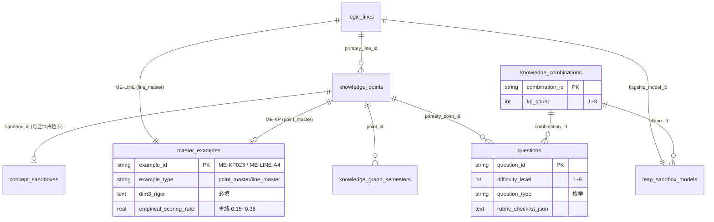

### 4.4 ETL 映射契约（TypeScript）

```typescript
/** 前端消费用扁平记录 */
export interface FlatQuestionRow {
  question_id: string;
  source: string; exam_year?: number; region?: string; exam_type: string;
  grade_level: number; semester: number;
  primary_point_id: string; combination_id?: string;
  difficulty_level: number;            // 1~9
  question_type: 'single_choice' | 'fill_blank' | 'solution';
  score_default: number;
  stem_zh: string; stem_en: string;
  options_json?: string;               // JSON.stringify(Record<'A'..'D', {zh,en}>)
  answer_standard: string;
  rubric_checklist_json?: string;      // JSON.stringify(RubricStep[])
  solutions_json?: string;
  image_paths_json?: string;
}

/**
 * 契约适配核心：上游打包 JSON → 前端扁平行（无损映射关键业务字段）
 * 注意：本函数为纯映射；LaTeX 二次清洗由 sanitize_and_verify_math() 承接（见 §6）。
 */
export function adaptQuestion(u: UpstreamPackedQuestion): FlatQuestionRow {
  return {
    question_id: u.question_id,
    source: u.meta.source, exam_year: u.meta.exam_year, region: u.meta.region,
    exam_type: u.meta.exam_type,
    grade_level: u.meta.grade_level, semester: u.meta.semester,
    primary_point_id: u.tagging.primary_point_id,
    combination_id: u.tagging.combination_id,
    difficulty_level: u.tagging.difficulty_level,
    question_type: u.tagging.question_type,
    score_default: u.tagging.score_default ?? 2,
    stem_zh: u.content.stem.zh, stem_en: u.content.stem.en,
    options_json: u.content.options ? JSON.stringify(u.content.options) : undefined,
    answer_standard: u.content.answer_standard,
    rubric_checklist_json: u.rubric
      ? JSON.stringify(u.rubric.map(r => ({
          stepIndex: r.step, descriptionZh: r.desc.zh, descriptionEn: r.desc.en, points: r.score,
        })))
      : undefined,
    solutions_json: u.solutions ? JSON.stringify(u.solutions) : undefined,
    image_paths_json: u.images ? JSON.stringify(u.images) : undefined,
  };
}
```

> **开发解耦**：前端可先用 mock `math_junior.db`（满足 §3.2 契约条款）独立开发，不阻塞于上游交付。

---

## 5. 内容生成策略（构建期大模型生成）

### 5.1 定位（A1 决策）
以下**前端核心内容**由**本项目在构建阶段调用大模型**按"母题生成策略"生成后落库，**不是靠独立 skill 预灌**：

- 119 母题四维解剖：`dim1_origin` / `dim2_essence` / `dim3_rigor` / `dim4_traps`
- 107 考点四段精讲：`origin_story` / `intuitive_essence` / `formal_definition` / `intrinsic_variation`
- 12 主线精讲：`origin_foundation` / `spiral_leaps` / `methodology` / `exam_matrix`
- 沙盒配置文本：`inquiry_guide` / `model_brief`（30~45 字动作口诀）

### 5.2 生成管线

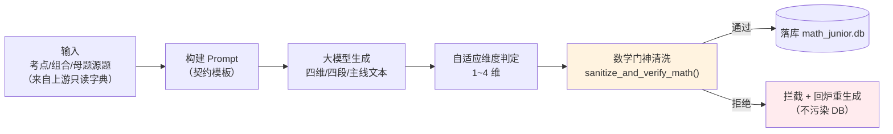

### 5.3 大模型 Prompt 契约（母题四维解剖示例）

```typescript
interface MasterExamplePromptContract {
  role: '资深中考数学命题与阅卷专家';
  input: {
    point_id?: string; line_id?: string;   // 二选一
    combination_id?: string;
    source_question: string;                // 母题源题（含 LaTeX）
    is_geometry_or_function: boolean;       // 是否几何/函数大考点（驱动能深必深）
  };
  output_schema: {
    dim1_origin?: string;   // 原点建模/题眼挖掘（可空）
    dim2_essence?: string;  // 几何不变/本质直观（可空）
    dim3_rigor: string;     // 严密推导 + 生死红线（必填）
    dim4_traps?: string;    // 极端反例/致命变式（可空）
    available_dimensions: Array<'dim1'|'dim2'|'dim3'|'dim4'>;
  };
  constraints: string[];    // 见 §5.4
}
```

### 5.4 自适应 1~4 维判定规则（能深必深铁律）

| 梯队 | 适用考点 | 维度要求 |
| :--- | :--- | :--- |
| 四维完全穿透 | 二次函数、圆、相似等约 40 个大考点 | dim1~dim4 **全做满** |
| 三维进阶 | 方程应用、勾股、反比例等约 35 个 | dim2 + dim3 + dim4 |
| 双维核心 | 因式分解、绝对值、不等式性质等约 20 个 | dim2 + dim3 |
| 一维直击 | 科学记数法、同类项判断等约 12 个纯离散概念 | 仅 dim3 |

**铁律**：几何图形 / 函数图像 / 综合方程等大考点，母题解剖深度**强制 ≥ 3 维**（优先做满 4 维）；只有纯符号约定或离散运算法则方允许收敛至 1~2 维。`dim3_rigor` **恒为必填**（属性 P12b）。

### 5.5 强制清洗门禁
**所有**大模型生成内容在 `INSERT/UPDATE` 之前**必须**通过 `sanitize_and_verify_math()`（见 §6.1）。未通过者拒绝落库并回炉重生成，脏公式**绝不进 DB**（属性 P15）。

---

## 6. 数学排版单入口·单出口门神

系统将数学公式的风险点物理收束为 1：**唯一入库入口**（构建期 Python 清洗）+ **唯一出库出口**（运行期 React 渲染组件）。业务层严禁私自 `import katex` 或写 `innerHTML`。

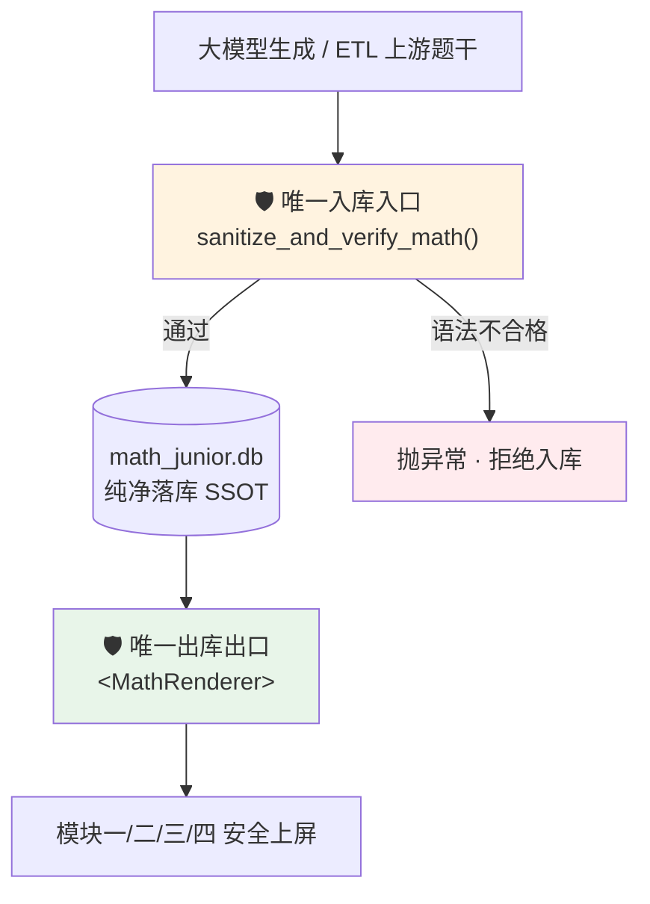

### 6.1 入库门神 `sanitize_and_verify_math()`（构建期，Python）
职责（沿用 detailed_design.md §8.1）：
1. **定界符归一**：`\( \)`→`$...$`、`\[ \]`→`$$...$$`、全角 `＄`→`$`。
2. **符号标准化**：`*`→`\times`、`÷`→`\div`、`度`→`^\circ`、`Rt△`→`\text{Rt}\triangle`、`△`→`\triangle`。
3. **反斜杠转义加固**。
4. **Headless 语法预检拦截**：花括号计数、`\begin`/`\end` 环境闭合校验；不通过 `raise ValueError`，**拒绝写入 SQLite**（属性 P1a、P1b）。

### 6.2 出库门神 `<MathRenderer>`（运行期，React）
契约（沿用 detailed_design.md §8.2）：

```typescript
interface MathRendererProps {
  content: string;      // 混合 Markdown / LaTeX
  block?: boolean;
  className?: string;
}
```

关键不变量：
- `katex.renderToString(..., { throwOnError: false, errorColor: '#ef4444', strict: false, trust: false })`：语法瑕疵仅局部标红，**宿主页面永不白屏/崩溃**（属性 P2a）。
- **全局 LRU 缓存**（容量 1000）：同一文本连续渲染结果一致，滚动零掉帧（属性 P2b）。
- 公式色彩继承 `currentColor`，明暗模式零延迟；WebKit 强制内嵌本地 WOFF2。
- `escapeHtml` 防 XSS；`trust:false` 杜绝脚本注入。

---

## 7. 四大模块设计

### 7.1 模块一：探本溯源·概念精讲
**结构**：每考点 4 个连续部分，单屏自闭环视窗（非瀑布流）。

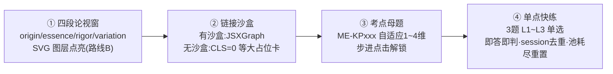

- **四段论**：读 `knowledge_points` 四段字段，经 `<MathRenderer>` 渲染。SVG 第 2 段隐藏字母图层、第 3 段淡入点亮（`<g class="formal-labels">` opacity 0→1）。
- **链接沙盒**：`sandbox_id` 非空→渲染实验室一沙盒；为空→渲染物理等大占位卡（CLS=0）。
- **考点母题**：读 `master_examples`（`example_type='point_master'`），按 `available_dimensions` 步进解锁；`dim3_rigor` 必展示。
- **单点快练**：抽题状态机（§7.1.1）。

#### 7.1.1 单点快练抽样去重状态机

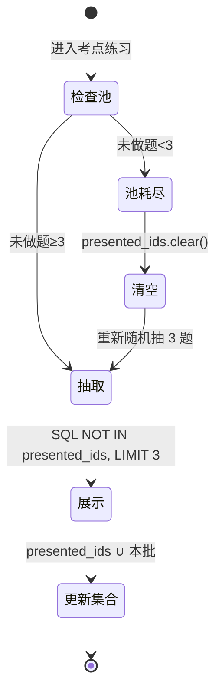

SQL（参数化，`?` 占位防注入）：

```sql
SELECT question_id, stem_zh, stem_en, options_json, answer_standard
FROM questions
WHERE primary_point_id = ?
  AND difficulty_level BETWEEN 1 AND 3
  AND question_type = 'single_choice'
  AND question_id NOT IN (/* presented_ids 占位数组 */)
ORDER BY RANDOM() LIMIT 3;
```

> **业务锁不变**：模块一单点快练锁 **L1~L3**，与组合基数无关（§11.3）。

### 7.2 模块二：经纬纵横·思维图谱（纯静态 + 焦点穿透，已删诊断）
6 学期（经度）× 12 主线（纬度）泳道地铁图；107 考点锚定网格槽位，`knowledge_graph_semesters` 的 493 条依赖边连通。

**保留能力（纯静态知识结构）**：
- **焦点穿透**：点击考点，无关节点 opacity→0.15；**入度光束**（蓝，前置地基，读 `predecessors`）；**出度光束**（紫，后继演化，读 `successors`）。
- **组合视图**：右侧滑出考点档案，列出包含该考点的 Top 组合（Clique），组合节点数按 `kp_count` **1~8 动态渲染**（属性 P7）。
- **跳板**：提供跳转【概念精讲】【沙盒探究】【专项测评】的直达入口。
- **主线四位一体闭环**：主线精讲（`logic_lines` 四段）+ 实验室二旗舰模型（`flagship_model_id`）+ 主线母题（`ME-LINE-xx`）+ 3 题主线快练（**L4~L6**）。

**删除能力（B1）**：❌ 节点掌握度着色、❌ `traceRootCause`、❌ 红色脉冲溯源线、❌ 靶向就医卡片。图谱**不做任何基于历史数据的诊断与节点着色**。

> **业务锁不变**：模块二主线快练锁 **L4~L6**，与组合基数无关（§11.3）。

### 7.3 模块三：见微知著·实验探究
双轨沙盒（实验室一约 40~50 概念沙盒 / 实验室二 36 跃迁模型），统一 JSXGraph 声明式驱动，详见 §9。

### 7.4 模块四：百炼成钢·实战测评

#### 子系统 A：精准出题中心
- 满分制一键套用（100/120/150 分制）、预设卷库、自定义工作台（107 考点复选 + L1~L5 难度滑块）。
- **库存方案 A 预警拦截** `verifyPaperInventory()`：任一题型需求 > 库存 → `canGenerate=false` 且禁用生成按钮（属性 P11）。
- 双栏 A4 打印导出（`@media print`，`page-break-inside: avoid` 防截断）。
- **母题物理隔离**：组卷抽题**只查 `questions`**，绝不触及 `master_examples`（属性 P12a）。

#### 子系统 B：在线测评中心
- 左右解耦 Split-View（左卷滚动 / 右指挥舱 sticky 静止）；全局唯一数学键盘（onFocus 呼出）。
- **填空判分**：受控解析器（§8.1）。**解答判分**：rubric 自核打钩（§8.2）。
- 四维认知素养雷达图；**考完即焚**（零持久化，属性 P13）。

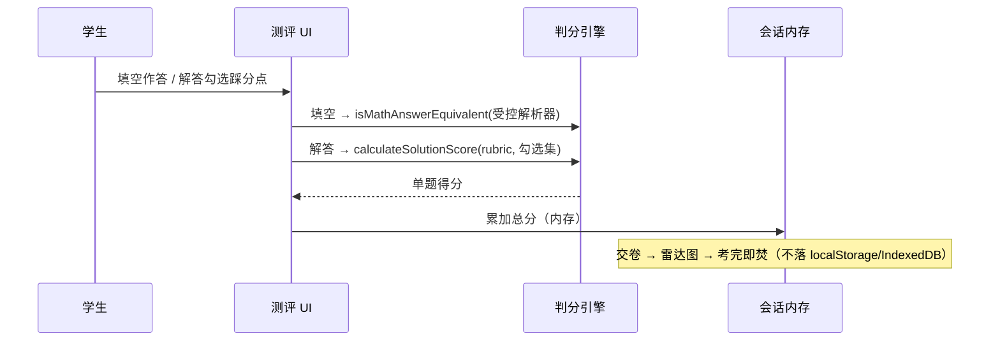

---

## 8. 判分引擎（A3 + B2）

### 8.1 填空题：规范化清洗 + 数值代入抽样验算（禁用 eval/Function）

> **关键安全约束**：**严禁使用 `Function()` / `eval` 对学生输入求值**。必须用**受控白名单表达式解析器**（自研 tokenizer + 递归下降，或引入 mathjs 等安全库并禁用其危险特性）。这修正了 detailed_design.md §10.1 中用 `Function()` 求值的写法。

判分流程：

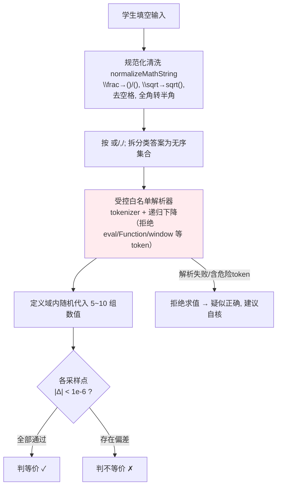

```typescript
/** 规范化清洗（纯字符串变换，无求值） */
export function normalizeMathString(raw: string): string {
  if (!raw) return '';
  return toHalfWidth(raw)                              // 全角转半角
    .trim().replace(/\s+/g, '')                        // 去空格
    .replace(/\\frac\{([^}]+)\}\{([^}]+)\}/g, '($1)/($2)')
    .replace(/\\sqrt\{([^}]+)\}/g, 'sqrt($1)')
    .replace(/\\pm/g, '±').replace(/\\times/g, '*')
    .replace(/\\div/g, '/').replace(/\\pi/g, 'pi');
}

/** 受控白名单 AST（自研解析器产物）——不含任何 JS 求值能力 */
type Expr =
  | { kind: 'num'; value: number }
  | { kind: 'var'; name: string }
  | { kind: 'bin'; op: '+'|'-'|'*'|'/'|'^'; l: Expr; r: Expr }
  | { kind: 'call'; fn: 'sqrt'|'sin'|'cos'|'tan'|'abs'; arg: Expr }  // 白名单函数
  | { kind: 'neg'; arg: Expr };

/** 危险 token 硬拦截（安全不变量，属性 P4b） */
const FORBIDDEN = /\b(Function|eval|window|globalThis|constructor|import|require|process)\b|=>|`/;
export function parseControlled(input: string): Expr {
  if (FORBIDDEN.test(input)) {
    throw new ParseError('检测到非法标记，拒绝求值'); // 绝不进入任何 JS 求值路径
  }
  return recursiveDescentParse(tokenize(input));       // 仅产出白名单 AST
}

/** 纯数值求值器：仅遍历白名单 AST，无 eval */
export function evalExpr(ast: Expr, env: Record<string, number>): number { /* 递归数值计算 */ }

/** 填空等价判定：规范化 → 受控解析 → 定义域内多点代入抽样 */
export function isMathAnswerEquivalent(
  studentAnswer: string, standardAnswer: string, domainSamples: Record<string, number>[]
): boolean | 'suspect' {
  const ns = normalizeMathString(studentAnswer), nt = normalizeMathString(standardAnswer);
  if (ns === nt) return true;                          // 字面命中
  let astS: Expr, astT: Expr;
  try { astS = parseControlled(ns); astT = parseControlled(nt); }
  catch { return 'suspect'; }                          // 无法安全解析 → 疑似正确, 建议自核
  const samples = domainSamples.length ? domainSamples : sampleDomain(collectVars(astS, astT), 8);
  for (const env of samples) {                         // 5~10 组随机代入
    const a = evalExpr(astS, env), b = evalExpr(astT, env);
    if (!isFinite(a) || !isFinite(b)) continue;        // 跳过定义域外采样点
    if (Math.abs(a - b) >= 1e-6) return false;         // 任一点不等 → 不等价
  }
  return true;                                          // 各采样点数值等价
}
```

- **分类答案**：按 `或`/`,`/`;` 拆为无序集合，逐一集合比对（如 `x=1 或 x=2` 与 `x=2 或 x=1` 判等，属性 P4a）。
- **边界兜底**：解析失败或含未知构造 → 返回 `'suspect'`（"疑似正确，建议自核"），不误判扣分，也不求值。

### 8.2 解答题：中考标准分步踩分点自核打钩（rubric checklist）
rubric **来源**：由**内容生成层**随母题/真题一起生成（§5），落 `questions.rubric_checklist_json`。

```typescript
export interface RubricStep {
  stepIndex: number; descriptionZh: string; descriptionEn?: string; points: number;
}
/** 自核得分 = 打钩步骤分值之和，恒 0≤score≤maxScore（属性 P5） */
export function calculateSolutionScore(steps: RubricStep[], checked: Set<number>): number {
  return steps.reduce((s, st) => (checked.has(st.stepIndex) ? s + st.points : s), 0);
}
```

学生交卷后展开官方标准解答，逐条自核打钩，系统实时累加真实总分。

---

## 9. 沙盒引擎（B4）

### 9.1 统一底座与声明式驱动
- **JSXGraph** 作统一动态几何底座，**替代**"每个沙盒手写专用 React 组件"。
- **声明式配置驱动**：沙盒行为完全由数据库 JSON 字段驱动（`viewbox_spec_json` / `drag_points_json` / `param_sliders_json` / `invariants_display_json`），一个通用渲染器 `<SandboxRenderer>` 读取配置构建 JSXGraph 板。
- **`canvas_template` 语义修订**：从"React 组件名"改为**"配置模板 ID"**（指向一组声明式配置的预设骨架）。

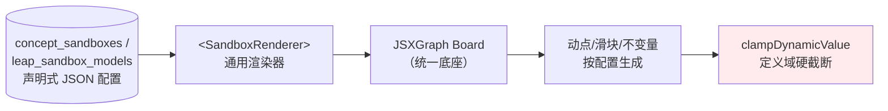

### 9.2 声明式配置契约

```typescript
export interface SandboxConfig {
  canvasTemplateId: string;                 // 配置模板 ID（原 canvas_template）
  engineType: 'geometry' | 'function' | 'number_axis';
  viewbox: {
    bbox: [number, number, number, number]; // [minX,minY,maxX,maxY]
    safePadding: number;                     // 固定 0.15（15% 安全边距）
    preserveAspectRatio: 'xMidYMid meet';    // 保形居中
    anchorToModelId?: string;                // 同主线 L1/L2/L3 统一标尺锚定到 Tier3
  };
  dragPoints: Array<{ id: string; constraint: MotionConstraint }>;
  paramSliders: Array<{ id: string; domain: [number, number]; step: number }>;
  invariantsDisplay: Array<{ label: string; formula: string }>; // 实时不变量
}
```

### 9.3 视口防溢出铁律（保留）
- **统一标尺锚定**：同主线 L1/L2/L3 共享 `viewBox`，锁定到 Tier3 最大包围盒，切换 Tab 时镜头比例尺与原点纹丝不动（属性 P6b）。
- **15% 安全边距**：极值位置外接矩形四周留白 ≥ 15%。
- **参数定义域硬截断**：`clampDynamicValue()` 纯数值 clamp，**非 `Function`**，到边界弹性阻尼停止（属性 P6a）。
- **`preserveAspectRatio="xMidYMid meet"`**：保形居中，零裁剪。
- **85% : 15% 纵向布局**：上画布 + 下极简文字指南（52~56px）。
- **CLS=0**：无沙盒考点渲染物理等大占位卡。

```typescript
/** 定义域硬截断（纯函数，禁用 Function/eval） */
export function clampDynamicValue(raw: number, c: MotionConstraint): number {
  const [min, max] = c.domain;
  return raw < min ? min : raw > max ? max : raw;      // 输出恒 ∈ [min,max]（属性 P6a）
}

/** 统一锚定视口：保形 + 含原 bbox + ≥15% 边距 + 中心对齐（属性 P6b） */
export function calculateMasterAnchoredViewport(
  envelope: BoundingBox, targetAspect = 4 / 3, safeMargin = 0.15
): ViewportSpec { /* 见 detailed_design.md §9.1，本项目保留算法 */ }
```

### 9.4 保留实验室
- **实验室一**：概念具象沙盒（约 40~50 个）。
- **实验室二**：思维跃迁模型（36 个），含 4D 变异控制器（载体/参数/姿态/干扰加壳）+ X-Ray 骨架透视。

---

## 10. UI/UE（C2 统一）

### 10.1 唯一设计语言：iOS 27 液态玻璃（Liquid Glass）
全平台**统一采用 iOS 27 液态玻璃设计系统**作为唯一设计语言。

> **冲突消解（C2）**：ui_ue 文档存在**两套自相矛盾**的重复内容——一套是 iOS 27 液态玻璃（§12.1/§12.2 前半），另一套是"彻底消灭 Emoji / 单一 Apple 蓝 / 白墙极简"（重复的 §12.1/§12.2 后半）。**本设计删除后者，全文归一到 iOS 27 液态玻璃这一套 token**。旧文档中重复的 Apple 极简 token 块作废。

核心设计哲学：液态多层玻璃拟态、超椭圆连续曲率（Squircle）、多维空间景深、物理弹簧微交互、内容至上。

### 10.2 统一 Token（唯一一套）

```css
:root {
  /* iOS 27 Dynamic System Colors */
  --ios-blue: #0071e3;      --ios-blue-glow: rgba(0,113,227,0.28);
  --ios-indigo: #5856d6;    --ios-purple: #af52de;   --ios-teal: #30b0c7;
  --ios-green: #34c759;     --ios-orange: #ff9500;   --ios-red: #ff3b30;

  /* Liquid Glass Surfaces */
  --glass-bg: rgba(255,255,255,0.68);
  --glass-bg-elevated: rgba(255,255,255,0.86);
  --glass-border: rgba(255,255,255,0.8);
  --glass-shadow: 0 8px 32px 0 rgba(31,38,135,0.08);
  --glass-shadow-deep: 0 20px 60px -10px rgba(0,20,60,0.12);

  /* Squircle Radius */
  --radius-sm: 12px; --radius-md: 18px; --radius-lg: 26px; --radius-pill: 9999px;

  /* Spring Physics */
  --spring-smooth: cubic-bezier(0.16, 1, 0.3, 1);
  --spring-bouncy: cubic-bezier(0.34, 1.56, 0.64, 1);
}
/* 暗色模式：玻璃面与文字前景切换深色变体（省略，遵循同一套语义变量，禁止硬编码 #000/#fff） */
```

> **注**：模块二删诊断后，旧 ui_ue §6 中 `--status-mastered/--status-fragile/--status-breakdown/--pulse-track` 一并**作废**，不进入 token 体系。

### 10.3 三端独立交互范式（保留）

| 终端 | 交互范式 | 关键规范 |
| :--- | :--- | :--- |
| 📱 手机 | 横向卡片穿透流（Card Deck）/ Bottom Sheet | 视窗 100dvh 锁定；拇指热区 ≥52px |
| 📟 平板 | 分栏画板（Split Master-Detail）/ 手写笔 | 左阶段导航 280px + 右画布；热区 ≥44px |
| 💻 电脑 | 宽屏剧场（Cockpit）/ Scroll-Snap / 快捷键 | 可折叠导航树；方向键/数字键直达阶段 |

### 10.4 设备检测调度引擎（保留）
`detectDeviceProfile()` 运行时特征判定（`matchMedia(hover/pointer)`、尺寸、纵横比、触控点数）→ 返回 `MOBILE`/`TABLET`/`DESKTOP` 之一（属性 P10）；支持全局手动 **override**（无需重载页面切换控制器）。

### 10.5 i18n
- 界面层：`locales/zh-CN.json` / `locales/en.json`，`[data-i18n]` 键绑定，广播事件全局热切换。
- 数据层：双语字段 `_zh`/`_en` 按当前 locale 投影（属性 P9）。
- 数学符号：中英环境 LaTeX 源码共用，仅文字翻译。

---

## 11. 命名与一致性规范（C4 / C5 / C3）

### 11.1 数据库文件名（统一）
全项目数据库文件统一为 **`math_junior.db`**（分包为 `core/master/sandbox/questions.db`，均属 `math_junior.db` 家族）。废弃其他命名。

### 11.2 ID 规范（全局唯一性）

| 实体 | 规范 ID 格式 | 示例 | 废弃写法 |
| :--- | :--- | :--- | :--- |
| 考点母题 | `ME-KP<3位>` | `ME-KP023` | ~~`M-KP023-01`~~ |
| 主线母题 | `ME-LINE-<主线>` | `ME-LINE-A4` | ~~`LM-A4-01`~~ |
| 概念沙盒 | `SB-KP<3位>` | `SB-KP023` | — |
| 跃迁模型 | `LM-<学期><序号>` | `LM-9A-19` | ~~`M-9A-19`~~ / ~~`LM-G5-01`~~ |
| 考点 | `KP-<3位>` | `KP-023` | — |
| 主线 | `<字母><数字>` | `A4` / `G5` | — |
| 组合 | `C<基数>-<序号>` | `C3-0112` | — |

**全局唯一性说明**：`example_id`、`model_id`、`sandbox_id`、`point_id`、`combination_id` 各自为所在表主键，全库唯一；母题 `ME-*` 与真题 `Q-*` 命名空间不重叠，配合表隔离（§11.4）双重保证不混。

### 11.3 组合基数 1~8（C3）
前端消费组合数据时**不得硬编码"最多 4 考点"**，按真实数据 **`kp_count` 1~8 动态渲染**（属性 P7）。影响范围：**仅**模块二 Clique 高亮节点渲染、模块四组卷抽题的节点渲染。

> **与业务难度锁互不相干（重要澄清）**：模块一单点快练锁 **L1~L3**、模块二主线快练锁 **L4~L6** 是**难度上限**业务设定，**与组合基数无关，保留不动**。

### 11.4 母题与真题物理隔离
`master_examples`（119 母题）与 `questions`（真题）物理分表；组卷/测评抽题**只查 `questions`**，母题绝不进考试题库（属性 P12a）。

---

## 12. 正确性属性（Correctness Properties）

*属性是应在系统所有合法执行中恒成立的行为特征——它是人类可读规范与机器可验证正确性保证之间的桥梁。以下属性经 prework 分析与冗余消解后得到（如"抽题增长列表长度"被"抽出题不在 presented_ids"覆盖等已合并），每条附**Validates** 注解与配套测试类型。所有属性测试最少 **100 次**随机迭代，标签格式：`Feature: math-junior-frontend, Property N: {property_text}`。*

### Property 1: 入库门神归一化闭包
*对于任意*含定界符 `\( \)` / `\[ \]` / 全角 `＄` 或符号 `*` / `÷` / `度` / `△` 的输入文本，`sanitize_and_verify_math()` 通过校验后返回的文本中，一律不再包含 `\(` / `\[` / `＄`，且乘/除/角度/三角符号已标准化为对应 LaTeX 命令。
**Validates: 需求 6.1（数学门神入库）、CT-4**

### Property 2: 不闭合公式必被拒绝入库
*对于任意*花括号计数不相等或 `\begin`/`\end` 环境数不匹配的公式片段，`sanitize_and_verify_math()` 必抛出异常并阻止其写入数据库。
**Validates: 需求 6.1（语法预检拦截）**（EDGE_CASE）

### Property 3: 出库渲染永不崩溃
*对于任意*字符串输入（包含畸形 LaTeX），`<MathRenderer>` 的渲染函数不抛出异常、返回非空 HTML 字符串，非法片段降级为标红 `math-error` 而非白屏。
**Validates: 需求 6.2（throwOnError:false 兜底）**

### Property 4: 出库渲染缓存幂等
*对于任意*文本，连续两次渲染返回完全相同的 HTML；且 LRU 缓存条目数恒不超过 `MAX_CACHE_SIZE`。
**Validates: 需求 6.2（LRU 缓存一致性）**

### Property 5: ETL 映射业务字段保真
*对于任意*合法上游打包记录，`adaptQuestion()` 产出的扁平行中，`question_id`/`primary_point_id`/`difficulty_level`/`question_type`/`answer_standard`/rubric 步骤分值等业务字段与上游对应值等价；且 `difficulty_level ∈ [1,9]`、`question_type` ∈ 枚举。
**Validates: 需求 3（数据消费层契约适配）、CT-1、CT-3**

### Property 6: 填空规范化清洗彻底性
*对于任意*含 `\frac{}{}`/`\sqrt{}`/空格/全角字符的答案字符串，`normalizeMathString()` 输出中不残留 `\frac`/`\sqrt`、不含空白字符、无全角字符。
**Validates: 需求 8.1（填空规范化清洗）**

### Property 7: 填空数值代入等价判定正确性
*对于任意*一对在共同定义域内数学等价的表达式，`isMathAnswerEquivalent()` 经 5~10 组定义域内随机代入后（各采样点 `|Δ|<1e-6`）判定为等价（`true`）；*对于任意*一对确实不等价的表达式，判定为 `false`。分类答案按 `或`/`,`/`;` 拆分后按无序集合比对。
**Validates: 需求 8.1（数值代入抽样验算、分类答案无序比对）**

### Property 8: 判分器对危险输入零求值（安全不变量）
*对于任意*包含 `Function`/`eval`/`window`/`constructor` 等危险标记的学生输入，受控解析器 `parseControlled()` 抛出解析错误并返回"疑似正确，建议自核"，全程不触发任何 JS 求值、不产生任何副作用（无全局状态被写）。
**Validates: 需求 8.1（禁用 eval/Function 安全约束）**（EDGE_CASE）

### Property 9: 解答题自核得分守恒
*对于任意* rubric 步骤集合与任意打钩子集，`calculateSolutionScore()` 返回值等于被打钩步骤分值之和，且恒满足 `0 ≤ score ≤ Σ(所有步骤分值)`。
**Validates: 需求 8.2（rubric 自核打钩）**

### Property 10: 动点参数硬截断有界性
*对于任意*原始值 `raw` 与任意定义域 `[min,max]`，`clampDynamicValue()` 输出恒 `∈ [min,max]`；且当 `min ≤ raw ≤ max` 时输出严格等于 `raw`。
**Validates: 需求 9（参数定义域硬锁死，禁用 Function）**

### Property 11: 沙盒统一视口保形与包容
*对于任意*包围盒，`calculateMasterAnchoredViewport()` 产出的视口宽高比等于目标比、完全包含原包围盒、四周留白 ≥ 15%、中心与包围盒中心一致；同主线 L1/L2/L3 锚定同一 `viewBox`。
**Validates: 需求 9（统一标尺锚定、15% 安全边距、保形）**

### Property 12: 组合基数 1~8 动态渲染
*对于任意* `kp_count ∈ [1,8]` 的组合数据，组合节点渲染/布局函数产出的节点数严格等于 `kp_count`，不因 `>4` 被截断。
**Validates: 需求（C3 组合基数 1~8）、CT-2**

### Property 13: 单点快练去重与池耗尽重置
*对于任意*题池与任意抽取序列，当池中未做题 ≥3 时抽出的题目均不在 `presented_ids` 中；当未做题 <3（池耗尽）时，系统清空 `presented_ids` 并仍能重新抽满 3 题。
**Validates: 需求 5.1（session 去重、池耗尽兜底）**

### Property 14: i18n 双语字段投影一致
*对于任意*含 `_zh`/`_en` 字段的记录与任意 locale，投影函数返回的展示字段在 `zh-CN` 时等于 `_zh`、在 `en` 时等于 `_en`。
**Validates: 需求 10（i18n 双语字段投影）**

### Property 15: 设备判定全域完备
*对于任意*运行时特征输入 `(isTouch, isFinePointer, isHoverable, width, height)`，`detectDeviceProfile()` 返回值恒 ∈ `{MOBILE, TABLET, DESKTOP}`（无 `undefined`）；存在手动 override 时返回 override 值。
**Validates: 需求（设备检测调度 + 手动 override）**

### Property 16: 组卷库存预警拦截正确性
*对于任意*题库存量与任意组卷配置，当且仅当任一题型的需求数超过其可用库存时，`verifyPaperInventory()` 返回 `canGenerate === false`（并禁用生成按钮）。
**Validates: 需求 5.4（库存方案 A 预警拦截）**

### Property 17: 母题与真题物理隔离
*对于任意*组卷/测评抽题结果，抽出的 `question_id` 集合与 `master_examples` 的 `example_id` 集合交集为空（母题绝不进考试题库）。
**Validates: 需求 5.4、CT-8（物理隔离铁律）**

### Property 18: 母题维度自适应约束
*对于任意*母题记录，`dim3_rigor` 恒非空、可用维度数 `∈ [1,4]`；且对标记为几何/函数大考点的母题，可用维度数 ≥ 3（能深必深）。
**Validates: 需求 5.（内容生成自适应 1~4 维）、CT-6**

### Property 19: 零持久化不变量
*对于任意*答题/沙盒/组卷会话操作序列，系统对 `localStorage` / `IndexedDB` 写接口的调用次数恒为 0。
**Validates: 需求（零持久化 / 考完即焚 / B1）**（EDGE_CASE）

### Property 20: SVG 资产无 foreignObject（WebKit 避坑）
*对于任意*生成或后处理产出的 SVG 资产字符串，均不包含 `<foreignObject>` 标签。
**Validates: 需求（WebKit 引擎兼容避坑规范）**

### Property 21: 生成内容清洗门禁
*对于任意*大模型生成内容，仅当其通过 `sanitize_and_verify_math()` 时才被写入数据库；未通过者被拦截且数据库不发生写入。
**Validates: 需求 5.（内容生成清洗门禁）**（EDGE_CASE）

### 测试策略
- **属性测试**（P1、P3–P7、P9–P18、P20）：≥100 次随机迭代，覆盖广域输入。使用 fast-check（TS）/ Hypothesis（Python 门神）。
- **边界/错误用例**（P2、P8、P19、P21）：EDGE_CASE，用生成器构造危险/畸形输入 + spy/mock 断言无副作用。
- **单元测试**：具体示例（如 `1/2` vs `0.5`、`x=1 或 x=2` 无序集合）、组件集成点。
- **集成/冒烟**（不做 PBT）：WASM 分包加载、i18n 热切换 DOM 联动、`@media print` 分页（用 1~3 个代表性用例）。
- **不可自动测**（人工评审）：iOS 27 液态玻璃观感、三端体感、内容"名师金标"质量。

---

## 13. 待验证的技术风险

| # | 风险 | 描述 | 验证/缓解手段 |
| :--- | :--- | :--- | :--- |
| R1 | **DB 体积与查询性能** | "20~50MB / 单查 <15ms" 为**待验证目标非承诺**。全库一次性载入内存在低端移动端可能 OOM 或卡顿。 | 分包按需加载（§2.3）+ Worker 只读连接 + 覆盖索引；实测各分包体积与 P95 查询耗时，必要时进一步拆包或改用 OPFS/分页游标。 |
| R2 | **JSXGraph 声明式复用度** | 40~50 概念沙盒 + 36 跃迁模型能否 100% 由声明式配置覆盖，存疑；复杂 4D 变异/瓜豆轨迹可能超出纯配置表达力。 | 先以 3~5 个代表模型（手拉手、阿氏圆、二次铅垂高）验证配置 DSL 覆盖度；预留 `customBehaviorId` 逃生舱挂载受控扩展（仍禁 eval）。 |
| R3 | **构建期内容生成质量** | 大模型生成的四维/四段/主线文本可能不达"名师金标"、维度判定失当或含幻觉红线。 | 门神 `sanitize_and_verify_math()` 拦截语法错误；建立教研人工抽检 + 回炉重生成闭环；对几何/函数大考点强制 ≥3 维校验。 |
| R4 | **受控解析器覆盖度** | 自研 tokenizer/递归下降或 mathjs 对中考填空表达式（根式、分式、绝对值、集合解）的覆盖可能不全，误判为 `suspect`。 | 用真题填空答案语料回归；`suspect` 时走"建议自核"兜底，绝不误扣分；持续扩充白名单文法。 |
| R5 | **WebKit / PWA 离线一致性** | Safari 对 WASM SQLite、Service Worker 缓存、WOFF2 内嵌、`backdrop-filter`（液态玻璃）表现差异。 | browserslist + legacy 降级；SVG 禁 foreignObject（P20）；三引擎真机矩阵冒烟测试。 |
| R6 | **上游契约漂移** | 上游 skill 打包 JSON 结构或组合基数、rubric 结构变更导致 ETL 破裂。 | ETL 入口做 schema 校验（zod 等）+ 契约条款 CT-1~CT-8 断言；mock db 与契约版本对齐。 |

---

## 附录 A：与旧文档的差异收敛清单（本文为准）

| 旧文档处 | 旧写法 | 本设计修订 |
| :--- | :--- | :--- |
| detailed_design §10.1 | 用 `Function()` 求值填空 | **改为受控白名单解析器**，禁用 eval/Function（§8.1、P8） |
| detailed_design §6 | `traceRootCause` 认知断层溯源 | **彻底删除**（B1、§1.3） |
| ui_ue §6 / §7.2 | 学情着色 token、脉冲红线动效 | **作废**（§1.3、§10.2） |
| ui_ue §12.1/§12.2（后半重复块） | Apple 极简 / 消灭 Emoji / 单一蓝 / 白墙 | **删除**，全文归一 iOS 27 液态玻璃（C2、§10.1） |
| detailed_design §1 | `canvas_template` = React 组件名 | **= 配置模板 ID**（B4、§9.1） |
| detailed_design §1 | 组合 `kp_count` 1~4 | **1~8** 动态渲染（C3、§11.3） |
| 各处 | `M-KP023-01` / `M-9A-19` / `LM-G5-01` 混用 | 统一 `ME-KP023` / `LM-9A-19` / `ME-LINE-A4`（C4/C5、§11.2） |
| technical_architecture §4.1 | 全库一次性载入内存 | **分包按需加载**（§2.3）；性能指标降级为待验证目标 |
